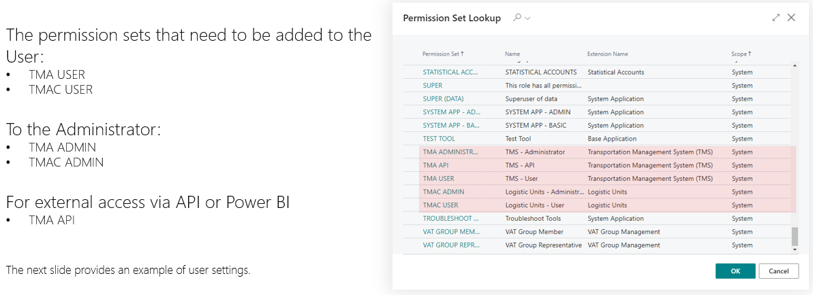
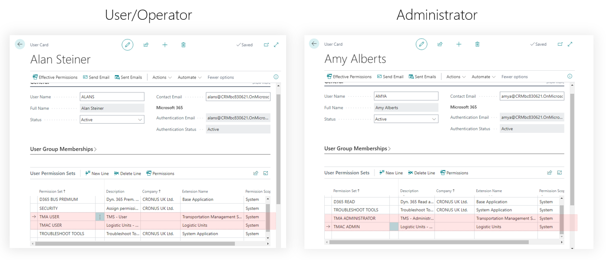

# Assign permission sets

Permission sets control which TMS pages and actions a user can access.

Assign permission sets after the app is installed and licenses are assigned.

## Which permission set to use

| User type | Permission set |
|---|---|
| Operations and finance users | **TMS User** |
| TMS administrators | **TMS Administrator** |
| API, Power BI, or integration users | **TMS API** |
| Custom role that works with Settlement | **TMA Settlement** |
| Capacity sourcing users, if enabled | **TMA Capacity Sourcing** |

Older permission sets with the `TMA` prefix can exist for compatibility. For new assignments, use the `TMS` permission sets unless your implementation guide says otherwise.

`TMS User`, `TMS Administrator`, and `TMS API` already include the complete **TMA Settlement** capability.
Settlement access is not divided by operation type: the same capability covers runtime processing, reconciliation,
reporting-currency revaluation, evidence review, posting, and archiving. Assign **TMA Settlement**
directly only when composing a custom role instead of using a standard TMS role.

`TMS User` also includes operational [Instructions](instructions.md) access. `TMS Administrator` adds maintenance rights for Instruction Types and master Instructions. The internal instruction capability sets are composed into these roles and normally should not be assigned directly.

## Recommended assignment pattern

| Role | Recommended access |
|---|---|
| Forwarding coordinator | **TMS User** |
| Dispatcher | **TMS User** |
| Finance user | **TMS User** |
| Setup administrator | **TMS Administrator** |
| External integration account | **TMS API** |

## Assign a permission set

### Users who only work with standard Business Central documents

Users who do not use TMS can open standard sales and purchase documents, Transfer Orders, Warehouse Shipments, and Warehouse Receipts with their normal Business Central and Logistic Units permissions. TMS does not require its user role just to open these document pages. TMS fields and actions retain their permission-based availability.

The **TMA BC Settl. Read** permission set provides indirect read access to active and posted Settlement and Freight Charge records for background link and allocation checks in documents, their lists, and their lines. It is included automatically through **LOGIN** and **System App - Basic**. If a custom role includes neither base set, include or assign **TMA BC Settl. Read** explicitly.

This technical access grants no insert, modify, or delete permission on these TMS tables and does not grant a TMS license. TMS actions and Instructions still require their applicable access. It does not replace the requirements for processing documents linked to TMS.

Existing legacy Transport Request and Delivery Charge links are maintained automatically when standard sales or purchase lines are deleted or recreated, including deletion after **Ship and Invoice** or **Receive and Invoice**. Posting also moves these links to the posted document and preserves the remaining Transport Request quantity during partial posting. These specific background operations can run without a TMS license; the user still needs the normal Business Central license and permissions for the document operation.

This access does not grant permission to open or manually edit transportation documents. Automatic Transport Request creation on release retains its existing setup and access checks. Other TMS processes, including Settlement processing, retain their own access requirements.

### Users who work with TMS

1. In Business Central, search for **Users**.
2. Select the user.
3. Open **User Permission Sets**.
4. Add the required TMS permission set.
5. Repeat for each user who must work with TMS.

## Verify

1. Ask the user to sign out and sign in again.
2. Search for **Forwarding Orders**.
3. Confirm the page opens.
4. Confirm the user can perform the expected task.

## Troubleshooting

| Problem | What to check |
|---|---|
| User cannot open TMS pages | Check license assignment and permission set assignment. |
| User can open pages but cannot configure setup | Assign **TMS Administrator** if the user is responsible for setup. |
| API calls fail with permission errors | Use an integration account with **TMS API** and company access. |

## Related

- [Buy licenses](buylicenses.md)
- [TMS Setup](setup.md)
- [API](api.md)
- [Instructions](instructions.md)
