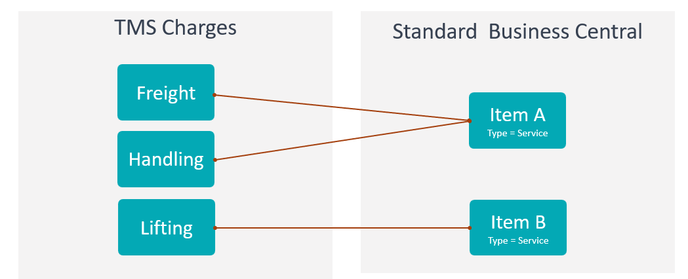

# Charges

Use **Charges** to define the cost types your company records for carrier, vendor, and operational expenses.

Charges are the cost side of settlement. Services are the customer billing side.

## Before you start

Make sure that:

- item charges or G/L accounts are available if costs are posted to Business Central financial documents,
- vendors and carriers are created,
- [Freight Agreements](freightagreement.md) are configured if charges are copied from carrier agreements,
- settlement rules are configured in [TMS Setup](setup.md),
- users understand which costs are estimated and which costs are actual.

## How to create a charge

1. Search for **Charges (TMS)**.
2. Choose **New**.
3. Enter **No.** and **Description**.
4. Set **Purchase Line - Type** and **Purchase Line - No.** to the Business Central line type and record used for this cost.
5. Fill **Unit of Measure Code** and **Default Vendor No.** when the charge should supply these defaults.

## Fields that matter most

| Field | Why it matters |
|---|---|
| **No.** | The charge identifier selected in **Code** on settlement lines. |
| **Description** | Appears on cost lines, reports, and documents. |
| **Unit of Measure Code** | Supplies the default unit for the charge quantity. |
| **Default Vendor No.** | Supplies the default supplier for the cost. |
| **Purchase Line - Type** | Defines the Business Central purchase line type, such as **G/L Account**, **Charge (Item)**, or a service **Item**. |
| **Purchase Line - No.** | Identifies the account, item charge, or service item. The purchase line must use the matching type and number when its cost is imported. |

## Where charges are used

| Area | Use |
|---|---|
| **Freight Order** | Records expected or actual carrier cost. |
| **Freight Agreements** | Defines reusable carrier cost lines and calculation flags. |
| **Settlement** | Allocates cost to the Forwarding Order and calculates margin. |
| **Purchase Assignment** | Maps vendor purchase lines into Freight Order charges and settlement cost. |
| **Purchase processing** | Supports vendor invoice or cost document creation. |
| **Reporting** | Shows cost structure by charge type. |

## Good to know

- Use short, stable charge codes. They become reporting dimensions for cost analysis.
- Keep service codes and charge codes separate. It helps users understand income versus cost.
- For an ordinary manual Settlement **Cost** line, use **Financial Effect = Standard**. Enter **Quantity** and **Price** as they should appear on the purchase document: with **Pricing Mode = Per Unit**, quantity `1` and price `700` produce **Amount = 700** and **P/L Amount = -700** before discounts.
- With **Pricing Mode = Fixed Amount**, enter the document amount before line discount, normally **Amount = 700** for a cost of `700`. Settlement applies the financial direction to P/L automatically. Deliberately negative quantities, prices, and amounts remain available. For supplier credits, use **Financial Effect = Credit** and review the [quantity, price, and amount signs](settlement.md#quantity-price-and-amount-signs).
- When a vendor invoice already exists, follow [Purchase Assignment](purchaseassignment.md) to import its cost. Check for a matching draft cost first so that the invoice does not duplicate an estimate.

## Troubleshooting

| Problem | What to check |
|---|---|
| Charge cannot be selected | Check the charge exists and is included in the Forwarding Order Type's allowed service/charge set when one is configured. |
| Cost does not post correctly | Review **Purchase Line - Type**, **Purchase Line - No.**, vendor, and Business Central posting setup. |
| Margin is wrong | Review **Financial Effect**, **Pricing Mode**, amount signs, currency, allocation, and duplicate costs. |
| Cost cannot be allocated | Check the settlement line status and linked Forwarding Order. |
| Purchase invoice line cannot be matched | Check charge setup and [Purchase Assignment](purchaseassignment.md). |

## Related

- [Settlement](settlement.md)
- [Services](services.md)
- [Freight Agreements](freightagreement.md)
- [Purchase Assignment](purchaseassignment.md)
- [Freight Order](freightorder.md)
- [TMS Setup](setup.md)
