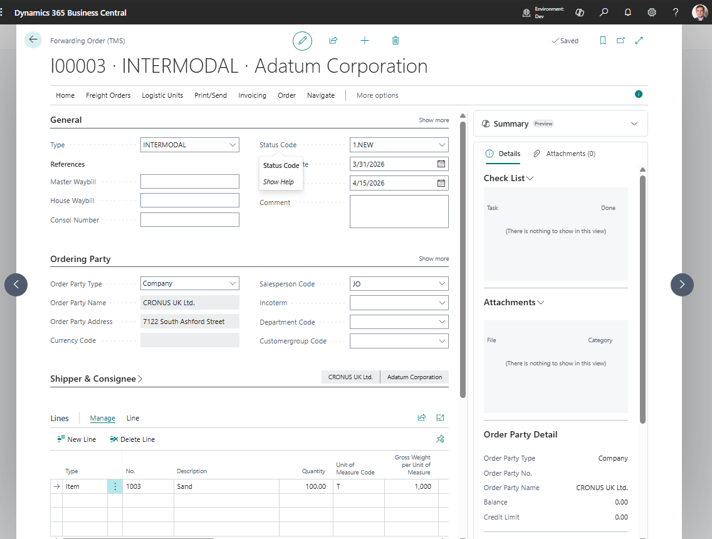

# Forwarding Order

Use a **Forwarding Order** to manage a customer transportation job from request to posted history.

The Forwarding Order defines what must be moved, who ordered the transportation, origin and destination parties, cargo, dates, stages, services, costs, and settlement.

**One Forwarding Order can have separate invoices for different customers.** Change **Order Party No.** to the customer you want to invoice next; earlier linked or posted invoices retain their original customers. See [Change the Ordering Party](#change-the-ordering-party).

## Before you start

Make sure that:

- a [Forwarding Order Type](forwardingordertype.md) exists,
- status and stage profiles are configured,
- customers, vendors, contacts, or locations exist for the involved parties,
- [Services](services.md) and [Charges](charges.md) exist when settlement is used,
- map locations exist when route or distance calculation is used.

## What lives on a Forwarding Order

| Part | Use it for |
|---|---|
| **General** | Order number, type, status, references, dates, and commercial terms. |
| **General > Correction** | Financial-correction flag and original posted order. Shown for financial correction orders. Financial results appear in Settlement. |
| **Ordering Party** | The customer or party that ordered and usually pays for the job. |
| **shipper** | The party that releases the cargo. |
| **Consignee** | The party that receives the cargo. |
| **Content** | Goods, products, logistic units, or unit types being transported. |
| **Stages** | Transportation legs that can be executed through Freight Orders. |
| **Settlement** | Income, cost, allocation, invoicing, and margin. |
| **Attachments** | Files required for compliance, customer communication, or posting. |
| **Check List** | Operational tasks for the order. |
| **Instructions** | Rich-content operational guidance inherited from type, consignee, address, or Sales Order, plus manual order-specific instructions. See [Instructions](instructions.md). |

## How to work in this page

1. Create a Forwarding Order.
2. Select the **Forwarding Order Type Code**.
3. Fill the ordering party.
4. Fill origin and destination party details.
5. Add content lines or logistic units.
6. Review stages created from the stage profile.
7. Add or calculate settlement lines.
8. Create Freight Orders for stages that need execution.
9. Attach required documents.
10. Complete and post every Freight Order assigned to the order's stages.
11. Post the Forwarding Order when its remaining operations, document, and financial controls are complete.

## Correct a posted invoice

Use **Correct**, **Cancel**, or **Create Corrective Credit Memo** on a linked posted sales or purchase invoice. Active FWOs receive new Settlement rows; posted FWOs are corrected through separate financial FWOs.

See [Invoice Corrections and Corrective Forwarding Orders](invoice-corrections.md) for the three workflows, allocation across orders, setup, and financial-result examples.

## Create a financial correction manually

A financial correction FWO adjusts the financial result of an existing posted FWO. It uses the same Settlement functions as an ordinary order and records the adjustment separately from the original history.

1. Choose **New** in Forwarding Orders.
2. Select a [Forwarding Order Type](forwardingordertype.md#types-for-financial-corrections) with **Financial Correction** enabled.
3. In **General > Correction**, select **Corrects Forwarding Order**. TMS uses the latest posted version of that order and fills in its saved Ordering Party details, currency, Responsibility Center, Salesperson, and Dimensions, as it does for an automatically created correction. The usual customer and status checks apply.
4. Enter the required Income or Cost rows in **Settlement**, then create or assign their financial documents as needed. Choosing the original FWO does not copy its Settlement or create a credit memo.
5. Complete the applicable financial and posting controls, then post the corrective FWO. An original posted order must be selected before posting.

**Financial Correction** is read-only on the card and comes from the selected type. The financial layout hides cargo lines, logistic units, **Shipper & Consignee**, **Plan**, **Stages**, and the related transport actions. Settlement, customer information, attachments, and financial totals remain available. Financial corrections do not create transportation stages, cargo, logistic units, Service Set defaults, or forwarding-agreement charges. Physical transport records cannot be added to these orders.

For a manually created correction, you can select, change, or clear **Corrects Forwarding Order** even after Settlement lines exist. Selecting an original updates the customer on unlinked Income and applies the original's saved Dimensions to editable Income drafts, retaining unrelated line dimensions. Linked and posted rows keep their customers, dimensions, amounts, and document links; Cost rows are unchanged. Clearing the reference keeps the current details and Settlement, but you must select an original again before posting the corrective FWO.

An order created by **Cancel**, **Correct**, or **Create Corrective Credit Memo** keeps the original selected by that operation; it cannot be reassigned manually. Use **New** and a financial correction type for another manual adjustment; copying a financial correction FWO is not supported.

Selecting a different original refreshes these details even when both originals have the same Ordering Party. Selecting the same original again preserves the saved version and any subsequent edits to the corrective order's details.

The original posted card's **General > Correction > Has Corrections** opens the list of linked orders. This field is not shown on active FWO cards. On an active corrective order, **Corrects Forwarding Order** provides a lookup for choosing the original posted order. On a posted corrective order, the same field opens the saved original version. The original order number and version are stored on the corrective FWO and retained after posting. Manual corrections have no document-correction operation ID.

Both automatic and manual corrections contribute to **Corrections (LCY)** and **Profit Including Corrections (LCY)** in **Settlement > Result Including Corrections**, below the usual Settlement totals. This group is shown when the order has corrections. The list and totals use the active corrective order when it exists, or its latest posted version, so each order is counted once. See [correction history and profit](postedhistory.md#invoice-cancellation-in-posted-history).

## Key actions

On an ordinary Forwarding Order, open **Freight Orders** to use **Create Freight Order**, **Assign Freight Order**, and **Freight Order List**. These actions are hidden for financial correction orders. When status action control is enabled, **Create Freight Order** in the current status controls whether the first two actions are enabled; it does not hide them.

| Action | Use it for |
|---|---|
| **Create Freight Order** | Create one new Freight Order and assign the full cargo to all selected unassigned stages. |
| **Assign Freight Order** | Create or assign carrier execution for a selected stage. |
| **Freight Order List** | Open unposted Freight Orders assigned to the Forwarding Order's stages. |
| **Logistic Unit Builder** | Create logistic units from selected content. |
| **Create Sales Invoice** | Create a customer invoice from eligible settlement Income lines with **Financial Effect = Standard**. |
| **Create Credit Memo** | Create a customer credit memo from eligible Income lines with **Financial Effect = Credit**. A negative amount alone does not select a credit memo. |
| **Sync with Sales** | Check linked sales lines and add eligible new Income lines to the existing open sales document. |
| **Attachments** | Add or review files for the order. |
| **Post** | Move the order to posted history after all assigned Freight Orders are posted and the order's controls pass. |

**Print Invoice** prints the unposted sales documents found for this Forwarding Order whose **Sell-to Customer No.** matches the current **Ordering Party No.**; several invoices for that customer can be printed together.

## Keep stage party and address details current

When you edit Shipper, pickup, Consignee, or delivery details in the Forwarding Order header, the corresponding saved details on all its existing stages are updated. This includes names, street addresses, country/region, city, post code, county, contacts, phone numbers, email addresses, notes, and delivery GLN. Clearing a value also clears its stage copy. Selecting a city or post code copies the resulting city, post code, and county together.

These stage details supply reports such as **Load Summary**. After correcting the delivery County or Post Code in the header, print the report again to use the updated stage values. Existing orders with older stage details are refreshed on the next edit to one of these header fields; installing the update alone does not rewrite existing orders.

The stages' **From Location** and **To Location** describe their individual route legs and use Map Locations. Editing an address component in the header keeps those route points and Freight Order assignments. Selecting a different party, address code, or header Map Location continues to use the existing route-update rules. Posted documents retain their archived details.

## Map locations and routes

**New Shipper MAP Location** and **New Consignee MAP Location** create a location from the selected party and address and assign it to the Forwarding Order. A new location can be saved without coordinates; the map opens only when its position is set.

To obtain coordinates, open the location in [Map Locations](maplocation.md) and choose **Geocode**. **Show Route** can create missing shipper and consignee locations. If either location has no position, the action keeps the locations it created and their assignments and asks you to assign and geocode the locations before trying again.

## Fields that matter most

| Field | Why it matters |
|---|---|
| **Forwarding Order Type Code** | Controls defaults, stages, statuses, and allowed behavior. |
| **Financial Correction** | Identifies a financial adjustment using the value copied from the FWO Type. Read-only on the order. |
| **Corrects Forwarding Order** | Identifies the original posted FWO; selecting it on a manual correction copies that order's Ordering Party. |
| **Status Code** | Controls which actions are available. |
| **Stage Profile Code** | Defines the transportation legs. |
| **Ordering Party No.** | Defines the customer for new sales documents and all unlinked Income. Earlier linked or posted Income can retain another customer. |
| **Origin and destination parties** | Define where cargo starts and where it goes. |
| **Requested and Planned Dates** | Drive operations and customer commitments. |
| **Total Income / Total Cost / Total Profit** | Shows financial result from settlement. |
| **Attachments** | Shows document completeness. |

## Change the Ordering Party

You can select a different customer in **Order Party No.** while earlier Income is linked to open or posted sales documents. Those lines retain their source customer, document links, and financial values. You can invoice any customer that passes the applicable status, customer, and financial checks, using separate invoices within the same Forwarding Order.

To invoice another customer for services on the same FWO:

1. In **Ordering Party**, set **Order Party Type = Customer** and select the customer's **Order Party No.**
2. In **Settlement**, add or review the unlinked **Income** lines and their amounts. Check the invoice **Currency Code** in **Ordering Party**. All existing unlinked Income is reassigned to the selected customer.
3. Choose **Create Sales Invoice**. The invoice uses the current Ordering Party customer.
4. To invoice another customer, repeat these steps on the same FWO. Existing linked or posted invoices keep their own customers and remain associated with the order.

Changing the customer updates **all unlinked Income**, including generated, Legacy, and Needs Review lines. Their prices, service-price currencies, exchange rates, saved financial values, verification state, and generation or correction references are preserved. Customer dimensions update on editable manual and Default Service Set drafts; other unlinked Income retains its saved dimensions. Review the whole unlinked Income set before changing the customer.

The header receives the new customer's default Forwarding Agreement, but existing Income is not regenerated from that agreement. An order without Income still receives its normal agreement charges. Explicit agreement selection or refresh keeps its normal generated-line restrictions.

For example, invoice customer A for the first services, change the Ordering Party to B, then add or review the remaining Income and create the next invoice for B. Both customers' linked Income remains on the same Forwarding Order. Normal invoice readiness checks still apply to every line before billing. Order status, customer blocking and credit controls, and the original-customer rule for financial corrections remain in effect. See [Change the customer for the next invoice](settlement.md#change-the-customer-for-the-next-invoice).

## Cargo net and gross weight

Content lines show **Net Weight** and **Gross Weight**, with separate values per unit of measure and totals for the line. Net weight is the goods without packaging; gross weight includes packaging. For a physical logistic unit, gross also includes its tare, while net excludes the tare of that unit and its nested units.

The additional **Net Weight** and **Gross Weight** columns labelled with the company's base weight unit show converted line totals and are read-only. **Total Net Weight** and **Total Gross Weight** below the lines are also read-only and add those base weights. The base weight unit comes from Logistic Units Setup, so lines entered in different weight units can be added correctly. Capacity planning uses gross weight; weight-based pricing continues to use its configured gross or chargeable weight basis.

**Weight Unit of Measure** identifies the unit of the numbers entered on the line. Item/UOM defaults and standard source-document weights automatically use the base weight unit from Logistic Units Setup. An empty weight-unit code also defaults to that base unit when the line or its weights are validated. Products and unit types can retain their own configured weight unit, and you can select another mass unit for manually entered weights. Changing this code reinterprets the entered numbers in the selected unit and recalculates the line; it does not convert the existing numbers merely for display.

Defaults depend on the cargo source:

| Cargo source | Weight defaults |
|---|---|
| **Item** | The selected Item Unit of Measure supplies **Weight** as net and **Gross Weight** as gross. If its gross is blank/zero, Logistic Units uses its net weight as the gross fallback; remaining missing values fall back to the Item and the quantity per unit of measure. |
| **Product** | The Product's own net and gross weights and weight unit. |
| **Logistic Unit** | The unit's saved net and gross base weights. |
| **Source document** | The source line's separate net and gross values; a missing value uses the Logistic Units item/UOM fallback. |

**Content Sets** also store separate net and gross weights per unit of measure. Selecting an Item UOM fills both defaults. When applying a Content Set to an order, a nonzero template weight overrides that weight's default; zero keeps the value calculated for the cargo. Existing templates with no net weight therefore keep the normal Item/Product net default.

For example, 10 DRUM with net weight 410 LB and gross weight 445 LB per DRUM gives line totals of **4,100 LB net** and **4,450 LB gross**. The footer shows these amounts in the configured base weight unit.

To enter actual line totals, edit **Net Weight** and **Gross Weight** in **Lines**, using the line's **Weight Unit of Measure**. These columns are visible by default and can be edited when line changes are allowed. When status control applies, the order's status must allow **Lines Change**.

Editing a total keeps **Net Weight per UoM** and **Gross Weight per UoM** unchanged; the difference is retained as a manual adjustment. For example, with quantity 10 and gross weight per UoM 100, entering gross weight 1,050 keeps the per-UoM value at 100 and records an adjustment of 50. Changing quantity, item UOM, per-unit weights, or the weight unit afterward recalculates the totals, so review any manual adjustment. Per-unit weights retain their precision; calculated line totals use the rounding precision of the line's weight unit.

For direct Item/Product lines, the Logistic Unit Builder keeps the precise per-unit net and gross weights while both line totals equal their normal rounded calculation. If either total has been changed from that calculation, the builder distributes both saved base totals in proportion to the selected quantity, preserving the edited pair. A logistic unit calculated from precise per-unit weights can therefore differ slightly from a rounded FWO total. Lines linked to a standard source document use that document's values when building logistic units.

**Check Net/Gross Weight** in **Logistic Units Setup** controls the comparison: when enabled and both weights are specified, net cannot exceed gross. Zero means unspecified for this comparison. Existing and posted orders retain their saved weights; changing item/UOM defaults does not rewrite historical cargo.

## Cargo volume

**Volume per UoM** describes one cargo unit; **Volume** is the line total. Item/UOM and standard source-document defaults automatically use **Base Volume Unit of Measure** from Logistic Units Setup. Empty volume-unit codes also default to that unit during insertion or volume validation. Products and unit types can use their configured volume unit, and another volume unit remains available for manual entry. Changing the volume-unit code reinterprets the numbers and recalculates the line.

A source line's nonzero volume takes precedence. Otherwise, TMS uses the selected Item UOM's **Cubage**, then the Item's **Unit Volume** multiplied by the quantity per UOM. Selecting an Item UOM copies its length, width, and height without replacing this supplied volume. Editing dimensions or their linear unit afterward recalculates volume from those dimensions.

Per-unit volume retains its precision; line totals use the volume unit's rounding precision. Direct Item/Product lines pass precise per-unit volume to the Logistic Unit Builder when the total matches the normal rounded calculation. An adjusted total is distributed in proportion to the selected quantity, including zero. Linked source-document lines continue to use their source document. **Total Volume** below the lines uses the base volume unit and refreshes after volume or dimension edits. Review manual totals after changing quantity, UOM, or dimensions because those changes recalculate them.

## Profit percentage

Turn on **Profit Calculation Enabled** in **TMS Setup** to show **Profit % (LCY)**, **Profit % (ACY)**, and the **Profit Calculation** action in the Forwarding Order lists. Choose the **Profit Calculation Method** in Setup:

| Method | Calculation |
|---|---|
| **Profit/Cost * 100%** | Profit divided by the absolute cost amount, multiplied by 100. |
| **Profit/Income * 100%** | Profit divided by the absolute income amount, multiplied by 100. |

LCY and ACY are calculated separately from Settlement totals. The result is rounded to a whole percentage point; a zero income or cost base gives 0%.

In the Forwarding Order list, apply the filters for the orders you want to recalculate, choose **Profit Calculation**, and confirm. The action saves the percentages for all orders in the current filtered list, including orders outside the visible rows. The same calculation is used in the list opened from a TMS chart.

The saved percentages do not refresh automatically when Settlement or the calculation method changes. Run **Profit Calculation** again after those changes. After copying an active or posted Forwarding Order, both percentages start at 0; review the copied Settlement and run **Profit Calculation** for the target order.

For example, income of 1,000 and cost of 800 give profit of 200. **Profit/Cost * 100%** gives 25%, while **Profit/Income * 100%** gives 20%.

The [Posted Forwarding Orders](postedforwardingorder.md#profit-percentage) list displays percentages using the current Setup without rewriting posted history.

## Invoicing Detail

The **Invoicing Detail** FactBox shows invoicing and payment totals in the company's local currency (LCY), so invoices in different currencies can be added together.

| Field | What it shows |
|---|---|
| **Ongoing Invoices** | Ongoing sales documents for the current Ordering Party customer. |
| **Ongoing Invoices by FWO** | Ongoing sales documents tied to this Forwarding Order, across all customers. Its drilldown and ongoing document amount and VAT totals include those customers too. |
| **Invoiced Amount (LCY)** | The full amounts of posted customer documents linked to the order, in LCY. |
| **Paid Amount (LCY)** | The settled portion of those amounts in LCY, including payments, applied credit memos, and payment discounts. This is an amount, not a percentage. |
| **Currency Code** | The company's local currency code from General Ledger Setup. |

These totals use the LCY amounts recorded in the customer ledger, without converting documents at today's exchange rate. They show full linked document amounts, which can differ from the share allocated to this order in **Settlement**.

## Posting requirements

Every Freight Order assigned to a Forwarding Order stage must already be posted. This requirement applies both to **Post** on the card and to posting selected orders from the list. Posting finds each completed stage by its Freight Order, Forwarding Order, and stage line, and refreshes the stored record links automatically, including on older orders. A stale stored link does not require a separate repair step when that completed stage is uniquely identifiable. An active Freight Order, missing trip history, or several matching historical stages still blocks posting.

If posting reports that related orders changed while it was being prepared, refresh and review the selected orders and their Freight Order assignments before retrying. The rejected attempt leaves no partial posting, including when several Forwarding Orders were selected together.

Freight Order posting closes carrier execution first, after its linked purchases are posted and its charges are fully allocated. The Forwarding Order can remain active afterward while customer income, sales invoicing, and required documents are completed. Its stage lines still identify the completed trip, but the saved execution and carrier cost details are historical snapshots. Forwarding Order posting links those stages to its own posted version; it does not create another Freight Order archive, remove the existing one, or rewrite its operational and financial facts.

For ordinary Settlement rows, Forwarding Order posting archives the saved quantities and financial values without comparing them with the current sales or purchase document. Technical source identifiers are refreshed from the existing document and line. Document Correction retains its separate source and correction-operation checks. Review financial values before closing the order; see [Archive Settlement when posting the Forwarding Order](settlement.md#archive-settlement-when-posting-the-forwarding-order).

Posting can be blocked by setup or status rules. Common blockers include:

- required settlement documents are not posted,
- Forwarding Order posting date is earlier than linked settlement document postings,
- required attachment categories are missing,
- current status does not allow posting,
- required fields, content, or stages are incomplete.

Files attached directly to the Forwarding Order move to its Posted Forwarding Order at this step. Shared carrier or trip files attached to a Freight Order remain with the Posted Freight Order created earlier. Open that related history to review them.

## Good to know

- The Forwarding Order defines **what** is transported and **who** ordered it.
- Freight Orders define **who executes** the transportation work.
- Settlement defines **how the order is billed and costed**.
- Before billing, follow [Add an Income line](settlement.md#add-an-income-line). Every Income line needs **Unit of Measure Code**, including fixed-amount lines.
- Enter Settlement quantity, price, and amount as they should appear on the target document. For an ordinary **Cost / Standard** line, quantity `1` and price `700` give **Amount = 700** and **P/L Amount = -700** before discounts. Fixed Amount follows the same document sign rule; deliberately negative inputs remain available. See [Quantity, price, and amount signs](settlement.md#quantity-price-and-amount-signs) for fixed amounts and credits.
- To record an existing vendor invoice, follow [Purchase Assignment](purchaseassignment.md). Importing its lines is a different operation from creating new purchase lines from settlement.
- Posted Forwarding Orders are read-only history.

## Troubleshooting

| Problem | What to check |
|---|---|
| Freight Order action is disabled | Check the current status and status profile. |
| Settlement actions are unavailable | Check status rules and user permissions. |
| Posting is blocked | First confirm that every assigned Freight Order is posted and the stages have valid posted links. Then review setup posting controls, required attachments, and settlement document status. |
| Totals look wrong | Recalculate settlement and review service, charge, currency, and allocation lines. |
| Route is not shown | Check map locations and map provider setup. |

## Related

- [Forwarding Order Types](forwardingordertype.md)
- [Freight Order](freightorder.md)
- [Forwarding Control Tower](forwardingcontroltower.md)
- [Settlement](settlement.md)
- [Invoice Corrections and Corrective Forwarding Orders](invoice-corrections.md)
- [Attachment Control](attachmentcontrol.md)
- [Posted Forwarding Order](postedforwardingorder.md)
- [AI and Copilot Features](copilot.md)
