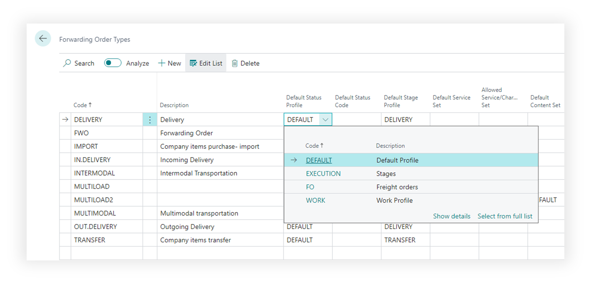

# Forwarding Order Types

Use **Forwarding Order Types** to define how different transportation jobs behave.

A type can represent an import job, export job, domestic move, air freight job, sea freight job, brokerage job, or any other process your company manages.

## Before you start

Make sure that:

- status profiles exist,
- stage profiles exist,
- services and charges exist if the type uses settlement defaults,
- report and attachment rules are understood by the business owner.

## How to create a type

1. Search for **Forwarding Order Types**.
2. Choose **New**.
3. Enter a code and description.
4. Select status and stage profiles.
5. Fill default values used on new Forwarding Orders.
6. Add reusable [Instructions](instructions.md) that should be considered for this type.
7. Configure document, attachment, and settlement behavior as needed.
8. Test the type by creating a Forwarding Order in a sandbox.

## Fields that matter most

| Field | Why it matters |
|---|---|
| **Code** | The type users select on the Forwarding Order. |
| **Description** | Helps users choose the correct process. |
| **Status Profile Code** | Controls allowed actions by status. |
| **Stage Profile Code** | Controls default transportation legs. |
| **Default Service Set** | Adds predefined income and cost lines to Settlement, including their Financial Effect and Pricing Mode. |
| **Default values** | Reduce manual entry on new orders. |
| **TMS Instructions** | Defines reusable instruction defaults considered when an FWO of this type is created. |
| **Posting and document settings** | Control completion rules and output. |

## Choose a default for a party or address

Set **Default FWO Type** on the **Customer Card** or **Vendor Card** when its documents normally require the same process. A default on the selected **Ship-to Address** or **Order Address** takes priority when the document's customer/vendor or address changes.

The suggested type is stored in **FWO Type** on the sales or purchase document. You can change it manually for a particular shipment until a Forwarding Order is linked. Creating the FWO uses this saved choice and applies the type's numbering, status, stage, and settlement defaults.

For example, a customer can suggest a domestic type with one stage, while its overseas Ship-to Address suggests a multimodal type. Selecting that address fills the document with the multimodal type; you can still choose another type on the document before creating the FWO.

Before an FWO is linked, changing the customer/vendor or address refreshes the suggestion. Later changes to master-data defaults do not update an existing document's type. A blank document field uses the existing TMS Setup and source-specific selection behavior. Posting and archiving preserve the saved type. Once an FWO is linked, the source document's **FWO Type** is read-only and its saved value is preserved when the customer/vendor or address changes. The lock remains after FWO posting.

Returns use the same defaulting rules, and their document type can be selected manually. The stage profile is not automatically reversed.

See [TMS Setup](setup.md#default-forwarding-order-type-by-customer-vendor-and-address) for the priority rules and [Business Central Integration](integration.md#default-fwo-type-from-source-documents) for supported sources.

## Default settlement lines

Use **Default Service Set** when a Forwarding Order Type should create standard Settlement lines automatically.

For every line in the Service Set, define:

- **Type** and **Service / Charge Code**,
- **Financial Effect**: **Standard** for the normal Income or Cost direction, or **Credit** for the opposite direction,
- **Pricing Mode**: **Per Unit** to recalculate from quantity and price, or **Fixed Amount** to keep the initially calculated total,
- quantity, unit of measure, price, currency, and the default customer or vendor when required.

When the type is applied to a Forwarding Order, TMS copies these settings into the generated Settlement line. Enter Service Set quantity and price as they should appear on the target document. The initial document Amount is calculated from quantity and price; the selected Income/Cost and Standard/Credit direction is applied separately to P/L. A **Fixed Amount** line then keeps its document total when later planning changes its quantity. If its quantity is zero, TMS treats **Price** as the fixed document total and uses the amount-only contract when creating a Business Central document line.

These copied lines are starting drafts, not a locked service list. Before they are linked to a Business Central document, users can change their type, service or charge, description, Financial Effect, Pricing Mode, quantity, price, amount, currency, account, and dimensions, or delete a line that is not needed. Normal Forwarding Order status, party, currency, and allowed-code rules still apply. TMS keeps the Service Set origin only so the Forwarding Order Type lifecycle can recognize and regenerate its default rows when applicable.

You can select the Ordering Party after these defaults have been created. If every Income line remains an editable manual or Service Set draft, TMS assigns the new customer to all Income lines together and preserves their service prices and currencies. The FWO invoice currency can be selected separately; conversion occurs when the sales document is created. If any Income line is already linked or posted, changes to the Ordering Party type, customer, and invoice currency are blocked for the whole FWO. Cost lines and their dimensions remain unchanged; see [Settlement](settlement.md#parties-and-source-documents).

## Setup decisions

| Decision | What it changes |
|---|---|
| Separate types by process | Gives users the correct stages and controls for each operation. |
| Separate types by mode | Makes air, sea, road, and multimodal jobs easier to report. |
| Use strict status control | Prevents users from invoicing, posting, or changing data too early. |
| Use attachment requirements | Blocks movement to controlled statuses until required files exist. |

## Good to know

- Keep type codes stable. They are used in filtering, reporting, and historical documents.
- Do not create too many types for small differences. Use stages, services, or references when the process is mostly the same.
- Test every new type with a real working example before users start using it.

## Troubleshooting

| Problem | What to check |
|---|---|
| New order has wrong stages | Check the stage profile selected on the type. |
| User cannot perform an action | Check the status profile and current status. |
| Required files are not enforced | Check extended control and attachment category rules. |
| Wrong defaults appear | Review **FWO Type** saved on the source document, then the source default in TMS Setup if the document field is blank. To check the original suggestion, review the address and customer/vendor **Default FWO Type**. |

## Related

- [Forwarding Order](forwardingorder.md)
- [Statuses and Status Profiles](statuses.md)
- [Stages](stages.md)
- [Attachment Control](attachmentcontrol.md)
- [TMS Setup](setup.md)
- [Instructions](instructions.md)
