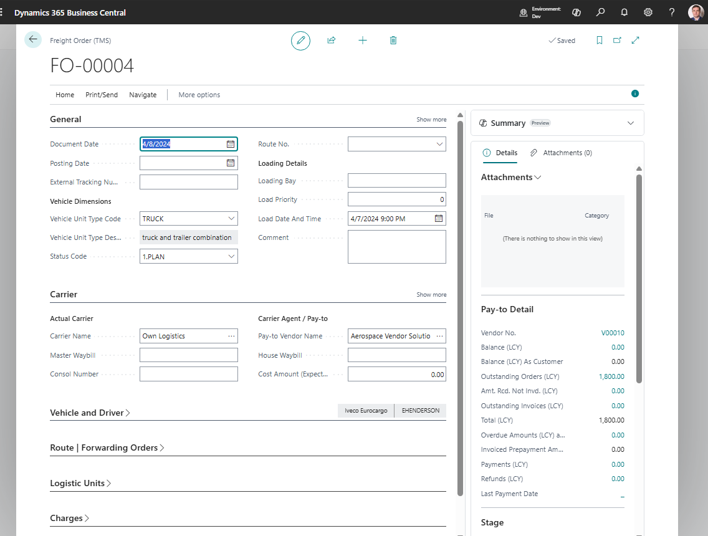

# Freight Order

Use a **Freight Order** to manage the carrier or internal resource that executes one or more transportation stages.

A Freight Order defines who performs the work, what content is carried, which stages are covered, and which carrier costs are expected or recorded.

## Before you start

Make sure that:

- a Forwarding Order with stages exists,
- a [Freight Order Type](freightordertype.md) exists,
- a carrier or internal executor exists,
- optional vehicle and driver records are ready,
- content or logistic units are available to assign,
- charges are configured if carrier costs are tracked.

## What lives on a Freight Order

| Part | Use it for |
|---|---|
| **General** | Freight Order number, type, document dates, status, and route summary. |
| **Date and Time Planning** | Loading and unloading dates, times, allowed windows, bays, and priorities. |
| **Carrier** | Actual carrier and pay-to vendor or agent. |
| **Vehicle and Driver** | Resource assignment for execution. |
| **Content** | Cargo, logistic units, or unit types assigned to the Freight Order. |
| **Stages** | Forwarding Order stages covered by this Freight Order. |
| **Charges** | Expected or actual carrier cost lines. |
| **Stage Entries** | Execution events, statuses, coordinates, images, and attachments. |
| **Attachments** | Carrier documents, confirmations, and execution files. |
| **Instructions** | Guidance copied from assigned FWO snapshots or added manually. See [Instructions](instructions.md). |

## How to work in this page

1. Create the Freight Order from a Forwarding Order stage or open an existing Freight Order.
2. Select the carrier.
3. Fill pay-to vendor details if the invoice vendor differs from the actual carrier.
4. Add vehicle and driver if they are tracked.
5. Review content and stage lines.
6. Add or review freight charges.
7. Assign purchase lines when carrier invoices must be matched to costs.
8. Print or email the required carrier documents.
9. Update execution information as the work progresses.

## Key actions

| Action | Use it for |
|---|---|
| **Show Route** | Display the route for this Freight Order. |
| **Route Optimization** | Optimize route sequence when map data is available. |
| **Freight Order** | Print the carrier instruction document. |
| **Email Freight Order** | Send the Freight Order as a PDF. |
| **Details** | Print logistic unit or cargo details. |
| **Load Summary** | Print a compact load overview, including lot numbers and stage-specific vehicle, regulation, transport-profile, formalized cargo-description, and package conditions. |
| **Packing List** | Print cargo packing information. |
| **Packing List by Container** | Print a separate packing list for each actual loaded outer LU, with products, lots, quantities, seals, and cargo gross weights. Available in the Packing List action group. |
| **Bill of Lading** | Print transport handover documentation. |
| **Dangerous Goods Bill of Lading** | In the Bill of Lading group, print actual loaded cargo with a separately resolved Transport Profile for each Item/Product. |
| **Check Vehicle Unit Type** | Check the related Stage profiles, cargo assignments, equipment rules, temperature boundaries, and Conditional instructions. |
| **Booking Confirmation** | Print confirmation for the carrier. |
| **Purchase Assignment** | Assign vendor purchase lines to Freight Order charges and settlement costs. |
| **Stage Entries** | Review execution events, statuses, images, attachments, and map points. |
| **Attachments** | Add or review Freight Order files. |

## Fields that matter most

| Field | Why it matters |
|---|---|
| **Carrier No.** | Identifies who executes the stage. |
| **Pay-to Vendor** | Identifies who is paid for the carrier service. |
| **Vehicle No. / Driver No.** | Supports planning, reporting, and execution documents. |
| **Mode of Transport** | Helps classify execution and documents. |
| **Bill of Lading No.** | Stores the number used by Bill of Lading reports; it can be supplied manually or assigned automatically at creation. |
| **Voyage Number** | Records the shipping line or vessel operator's reference for a voyage. |
| **Content totals** | Show capacity and cargo values. |
| **Freight charges** | Feed cost control and settlement. |

Enter the optional **Voyage Number** in **General**, using the reference from the booking confirmation or bill of lading. It accepts up to 50 text characters and preserves their case and format. Voyage Number identifies the voyage and is separate from the vessel's IMO Number, the carrier's SCAC, and Flight Number. Posting automatically saves it on the **Posted Freight Order**. Both the active and posted Freight Order APIs expose it as **voyageNumber**. **Voyage Number** is also available in the **Freight Orders** list; it is hidden by default and can be shown through personalization.

## Automatic Bill of Lading numbering

Configure **TMS Setup > Freight Order > Bill of Lading Numbering** to fill a blank **Bill of Lading No.** when creating a Freight Order:

- Leave **Numbering Method** blank to keep automatic numbering off.
- Choose **Prefix + Freight Order No.** to join **Prefix** directly to the Freight Order's own number. For example, **BOL-** + **FO-00001** becomes **BOL-FO-00001**. Include the separator in the prefix; a blank prefix uses the Freight Order number alone.
- Choose **No. Series** and select a series with **Default Nos.** enabled to obtain a number such as **BOL00001**. The series uses Document Date, falling back to the work date when Document Date is blank.

Prefix and No. Series are editable only for their matching method, and switching methods retains both values. The complete generated number must fit the 20-character Bill of Lading No. field; an overlong prefix result causes an error without truncation. See [TMS Setup](setup.md#bill-of-lading-numbering) for the three settings and series requirements.

Generation happens after the Freight Order number exists and applies to the card, wizards, and API creation, including an explicitly supplied Freight Order number. A Bill of Lading No. already supplied manually or through the API is preserved. Temporary records do not consume Bill of Lading sequence numbers.

Existing Freight Orders are not filled or renumbered when this setting changes. Later edits, renaming, and printing do not recalculate the number. Reports use the stored Bill of Lading No., and posting automatically copies it to the Posted Freight Order.

## Plan loading and unloading

Open the **Date and Time Planning** FastTab. The **Loading** and **Unloading** groups use the same fields:

| Field | Use it for |
|---|---|
| **Date** | Choose the date when the allowed window starts. |
| **Time** | Choose the time when the allowed window starts. |
| **Date Time** | Enter the combined start date and time. |
| **Window** | Enter the duration during which loading or unloading is allowed, for example 2 hours. This is an allowed window, not the actual handling duration. |
| **Window End** | Review the calculated end of the window. This field is read-only. |
| **Bay** | Identify the bay or staging area. |
| **Priority** | Record the loading or unloading priority. |

Changing Date or Time updates Date Time. Changing Date Time updates both Date and Time. Changing any start field or Window recalculates Window End.

For example, unloading on September 8 at 23:00 with a 2-hour window ends on September 9 at 01:00.

- Entering a date with a blank time uses midnight.
- You can enter a time before the date; the combined start and end remain blank until a date is entered.
- Clearing Date clears Date Time and Window End, but retains Time for later entry.
- Clearing Date Time clears Date, Time, and Window End.
- Window must be zero or greater. A zero window makes Window End equal to Date Time.
- Loading and unloading are planned independently; these fields do not reschedule the assigned stage lines.
- Posting preserves these values on the same FastTab of the **Posted Freight Order** card.

### Planning dates from assigned stages

After a successful **Assign Freight Order** assignment, the Freight Order's planning dates are recalculated from all stages assigned to it, including stages already attached and the newly assigned stages. Stages from other Forwarding Orders are included when they belong to the same Freight Order.

**Loading Date Time** becomes the earliest nonblank stage start date and time. **Unloading Date Time** becomes the latest nonblank stage end date and time. Each available boundary replaces the corresponding header value, including a manually entered value; previous header dates do not participate in the calculation.

The two values are independent: if no assigned stage has a start or end, the corresponding header value is retained. The separate Date and Time fields and Window End values synchronize automatically; Loading Window and Unloading Window durations remain unchanged.

The **Create Freight Order** wizard and the batch wizard's creation mode use the same stage-date calculation for a new order, retaining a creation default when its corresponding boundary is missing. The batch wizard's mode for adding to an existing order preserves its planning dates.

In step 4 of **Assign Freight Order**, **Create New Freight Order** is off by default. Selecting an existing order does not write or recalculate its dates before **Assign** succeeds. Turning on the creation option lets you review the stage's default carrier and vehicle unit type before **Assign** creates the order. Carrier is optional and Vehicle Unit Type Code is required. See [Order Wizards](orderwizards.md).

Manual card creation, including **New** from a Freight Order lookup, uses normal creation defaults and does not itself inherit stage dates. Completing **Assign Freight Order** for that order later recalculates its dates from all its assigned stages.

## Check Transport Profiles and equipment before execution

Set up the reusable scenarios and cargo assignments in [Transport Profiles and Dangerous Goods](transportprofiles.md). Select a profile on each relevant [Forwarding Order Stage](stages.md#select-a-transport-profile-on-an-order-stage), then:

1. Review each Stage's **Vehicle Unit Type Code**. A filled Stage value is used for that leg; a blank Stage value uses the Freight Order header value.
2. Select **Vehicle Unit Type Code** on the Freight Order. Its lookup intersects the equipment rules of profiles on Stages with blank equipment. Explicit Stage equipment does not restrict that header lookup.
3. Check **Temperature Control** and **Temperature**. Selecting a Vehicle Unit Type can supply these defaults from the type. When Temperature Control is on, use a common temperature unit across the Stage profiles because Freight Order has no separate temperature-unit field.
4. Choose **Check Vehicle Unit Type**. The explicit check requires a header Vehicle Unit Type, at least one linked Stage, and a Transport Profile on every linked Stage, including Service Stages.
5. Read any Conditional equipment instruction and confirm only after checking that the requirement is met. A confirmation is not stored as a lasting approval.
6. Repeat the check after changing cargo, assignments, profile data, equipment, or temperature.

No equipment rules means a profile places no equipment restriction. Once a profile has one rule, every unlisted type is rejected. Temperature boundaries can apply to Preferred and Allowed rules as well as Conditional rules. The lookup alone does not prove that those conditions are met.

Automatic save and Stage-assignment checks permit incomplete planning: they can skip Stages with no profile and skip equipment validation when the header Vehicle Unit Type is blank. They do not replace the explicit check. The feature does not add a separate transport-profile release/posting approval gate.

Before issuing **Dangerous Goods Bill of Lading**, fill **Bill of Lading No.**, load the actual logistic units, and review the first Stage's transport context. The report resolves a profile for each loaded Item/Product from cargo assignments; it does not use the selected Stage profile as a fallback. It also does not perform the full interactive equipment check. See [Reports and Documents](reports.md#dangerous-goods-bill-of-lading).

## Good to know

- A Forwarding Order can have several Freight Orders.
- When configured on the Stage Profile, the Default Pay-to Vendor flows through the Forwarding Order stage into a newly created Freight Order. A Pay-to Vendor linked through the selected Carrier remains the fallback when the stage has no default.
- One Freight Order can cover content or stages from more than one Forwarding Order when the operation allows it.
- Stage Priority follows the source Forwarding Order sequence when all stages belong to one FWO. Users can edit Priority only when the Freight Order combines stages from different Forwarding Orders.
- In a combined multi-FWO Freight Order, Priority values may interleave different FWOs but cannot reverse or duplicate the original stage order inside the same Forwarding Order.
- Freight Order charges can be distributed back to settlement.
- Purchase Assignment connects vendor invoice lines to Freight Order charges.
- Stage Entries give operations a timeline of execution events.
- Print and email actions use Business Central report selection and email setup.

## Troubleshooting

| Problem | What to check |
|---|---|
| Freight Order cannot be created | Check Forwarding Order status and stage selection. |
| Carrier defaults are missing | Check the carrier card for default vehicle, driver, and unit type. |
| Route is not shown | Check map locations on related stages and map provider setup. |
| Report is missing data | Review carrier, vehicle, driver, content, and stage lines before printing. |
| Vehicle Unit Type is missing or rejected | Review profile equipment rules, the Stage/header equipment precedence, temperature boundaries, and Conditional instructions. Run the explicit check after completing all Stage profiles. |
| Charges do not appear in settlement | Review charge distribution and settlement recalculation. |
| Vendor invoice line cannot be assigned | Check vendor, purchase document status, charge setup, and whether the line is already assigned. |

## Related

- [Forwarding Order](forwardingorder.md)
- [Freight Load Management](freightloadmanagement.md)
- [Freight Order Types](freightordertype.md)
- [Purchase Assignment](purchaseassignment.md)
- [Stage Entries](stageentries.md)
- [Settlement](settlement.md)
- [Reports and Documents](reports.md)
- [Carriers](carrier.md)
- [Transport Profiles and Dangerous Goods](transportprofiles.md)
