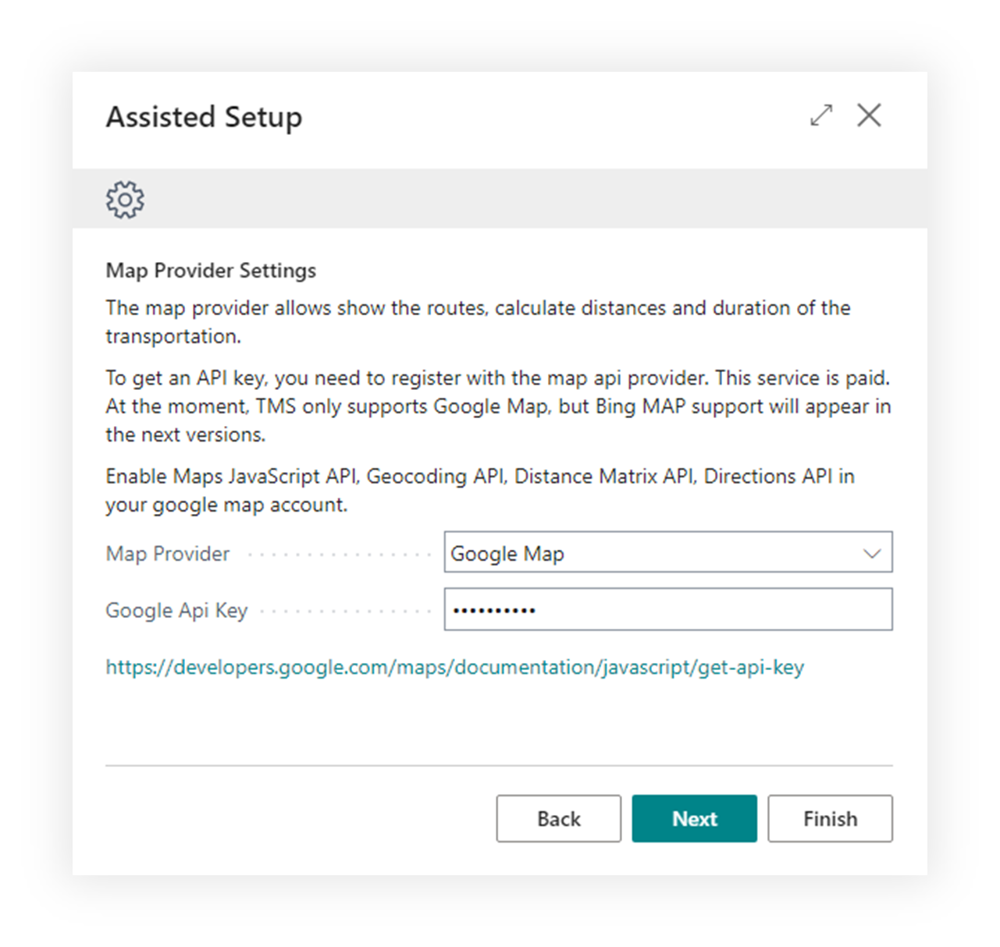

# Google Maps Integration

Use **Google Maps Integration** when TMS should calculate coordinates, show routes, or calculate distance and duration from map locations.

## Before you start

Make sure that:

- your company has a Google Maps Platform account,
- billing and the required Google APIs are enabled,
- an API key is created and restricted according to your security policy,
- users have permission to maintain TMS Setup and map locations.

## How to configure Google Maps

1. Create or open the Google Maps Platform project.
2. Enable the APIs required by your TMS process.
3. Create one Google Maps API key for TMS.
4. Configure API restrictions, quotas, billing alerts, rotation, and monitoring for that key.
5. Open [TMS Setup](setup.md).
6. Select Google Maps as the map provider.
7. Paste the key into **Google Api Key**.
8. Test geocoding on a [Map Location](maplocation.md).
9. Test route or distance calculation on a Forwarding Order or Freight Order.

TMS shows one field and stores the entered value in separate encrypted server and browser slots. The same value is used by Business Central service-tier requests and the browser map control. Consequently, TMS currently does not support separate IP-restricted and HTTP-referrer-restricted Google keys. Select restrictions that work for both request paths, and use API restrictions, quotas, rotation, monitoring, and billing alerts to limit exposure.

Only users with permission to modify **TMS Setup** can add, replace, or clear the shared key. TMS accesses it internally for normal map operations, so operations users do not need setup-maintenance rights to use maps. After migration, TMS reads the encrypted slots and does not use the obsolete plaintext table field as a fallback.

For dependent AL extensions, use the supported **TMA Map Management** business operations. Existing provider-specific business functions remain available, while the obsolete public `HasGoogleApiKey`, `GetGoogleApiKey`, and `SetGoogleApiKey` methods reject calls with an error. See the [credential model](mapproviders.md#credential-model).

## What Google Maps supports

| Capability | Use it for |
|---|---|
| **Geocoding** | Convert address details into coordinates. |
| **Map display** | Show a location or route on a map. |
| **Distance and duration** | Estimate route distance and travel time. |
| **Position correction** | Update coordinates when an address was matched incorrectly. |

## Good to know

- Google usage can create costs in your Google account.
- Restrict API keys. Do not share unrestricted keys with users or external systems.
- The configured Google key is supplied to the browser control and can be extracted by a browser user. Encryption protects it at rest, not while it is used in the browser.
- Address quality matters. Clean city, country, postal code, and street data gives better results.
- Geocoding and routing send address or coordinate data to Google. Review [privacy and outbound data transfer](mapproviders.md#privacy-and-outbound-data-transfer) before enabling the integration.

## Troubleshooting

| Problem | What to check |
|---|---|
| Geocoding fails | Check API key, enabled APIs, billing, and address quality. |
| Route is not shown | Check coordinates on all required map locations. |
| Distance is empty | Confirm map provider setup and that the document has valid origin and destination locations. |
| Google returns a permission error | Review API restrictions and enabled APIs in Google Cloud. |

## Related

- [TMS Setup](setup.md)
- [Map Providers](mapproviders.md)
- [Map Locations](maplocation.md)
- [Map Location Types](maplocationtype.md)
- [Forwarding Order](forwardingorder.md)
- [Freight Order](freightorder.md)
