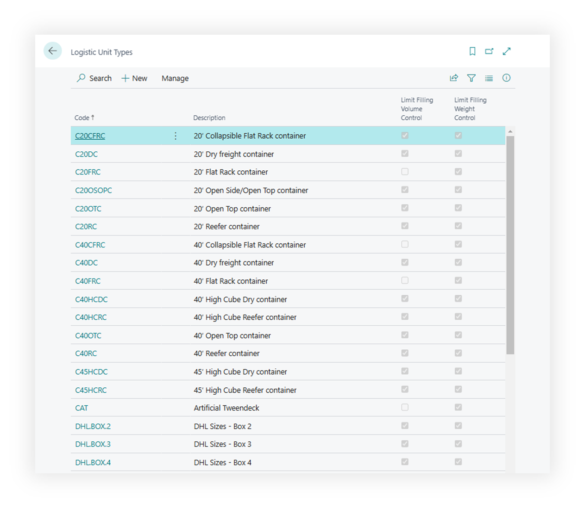

# Logistic Unit Types

Use **Logistic Unit Types** to describe the units used to pack, handle, or measure cargo.

Examples include pallet, box, crate, container, roll cage, tote, or any reusable unit type your operation tracks.

## Before you start

Make sure that:

- units of measure are defined,
- your company knows which dimensions and weight values should be maintained,
- users understand whether a unit type is a planning estimate or an exact handling unit.

## How to create a logistic unit type

1. Search for **Logistic Unit Types**.
2. Choose **New**.
3. Enter a code and description.
4. Fill default dimensions, weight, volume, and other capacity values when used.
5. Link handling or reporting defaults if your process requires them.
6. Save the record.

## Fields that matter most

| Field | Why it matters |
|---|---|
| **Code** | Identifies the unit type on content and logistic unit lines. |
| **Description** | Helps users choose the correct unit. |
| **Weight** | Supports capacity and cost review. |
| **Length / Width / Height** | Supports volume and dimensional planning. |
| **Volume** | Helps review cargo capacity. |
| **Blocked** | Prevents new use while preserving history. |

## Where unit types are used

| Area | Use |
|---|---|
| **Forwarding Order content** | Describes cargo units requested by the customer. |
| **Logistic units** | Builds structured cargo records. |
| **Freight Order content** | Shows what the carrier is expected to move. |
| **Reports** | Prints cargo and unit details. |
| **Transport Profiles and Stages** | Reuses existing unit types as Vehicle Unit Types and checks whether the chosen transport equipment is allowed for the cargo scenario. |

## Vehicle Unit Type, Package Type, and Transport Profiles

**Vehicle Unit Type Code** identifies the type of transport equipment used for a Stage or Freight Order. It refers to the existing Logistic Units type catalogue. A Transport Profile's **Package Type Code** describes how the cargo is presented for transport. For example, cargo may be packaged in drums while the Vehicle Unit Type describes the equipment carrying those drums.

Selecting a Package Type does not automatically choose or certify a Vehicle Unit Type. The relationship is configured on the **Transport Profile** card in **Vehicle Unit Type Rules**, or through the setup page with the same name.

1. Select an existing **Vehicle Unit Type Code** for each equipment type you want to govern.
2. Set **Compatibility Rule** to **Preferred**, **Allowed**, **Conditional**, or **Blocked**.
3. For Conditional use, enter the handling or equipment requirement in **Condition Text**, a temperature boundary, or both. Only confirm a displayed instruction after checking the actual equipment and shipment.
4. Set **Priority** to order suitable equipment. The current equipment lookup sorts displayed Priority from low to high within each compatibility group. Priority never overrides a prohibition or an unmet condition.

| Profile rules | Effect |
|---|---|
| No Vehicle Unit Type Rules | The Profile places no equipment-type restriction. |
| At least one rule | The list becomes closed: every unlisted type is rejected. |
| Preferred or Allowed | The type is permitted, subject to any defined temperature boundaries. |
| Conditional | The type must satisfy its temperature limits and any required confirmation of Condition Text. |
| Blocked | The type is prohibited for this Profile. |

For example, if fictional type `EQUIP-A` is the only **Allowed** row, `EQUIP-B` is rejected because it is unlisted. Adding only a **Blocked** row does not mean "allow all others": it also closes the list. Add all permitted types deliberately.

Transport Profile selection on a Stage considers its already selected Vehicle Unit Type. The Freight Order header equipment lookup considers only profiles on Stages whose Vehicle Unit Type is blank, because those Stages use the header as a fallback. A filled Stage Vehicle Unit Type remains authoritative for that leg and is checked separately. Lookup eligibility does not replace temperature and Conditional instruction checks.

Keep equipment conditions in the Profile rules and make sure the actual vehicle meets them. The feature does not add dangerous-goods certification or capability fields to Logistic Units and does not inspect the physical vehicle. For temperature limits, profile approval, and daily checks, see [Transport Profiles and Dangerous Goods](transportprofiles.md).

## Good to know

- Keep unit type descriptions user-friendly. They appear in lookup pages and documents.
- Block old unit types instead of deleting them.
- Unit type values can affect planning totals. Review defaults before go-live.

## Troubleshooting

| Problem | What to check |
|---|---|
| Unit type is not available | Check whether the record is blocked or filtered. |
| Capacity totals look wrong | Review weight, dimensions, volume, and quantity on the content line. |
| Report shows unclear cargo text | Improve unit type description and content description. |
| Vehicle Unit Type is absent from the Freight Order lookup | Check the Transport Profiles of Stages with blank equipment. One unlisted or Blocked combination in those profiles excludes the header equipment candidate. |
| An allowed type fails validation | Check temperature boundaries and any Conditional instruction; Preferred and Allowed rules can also carry temperature limits. |

## Related

- [Forwarding Order](forwardingorder.md)
- [Freight Order](freightorder.md)
- [Product](product.md)
- [Transport Profiles and Dangerous Goods](transportprofiles.md)
- [Stages](stages.md)
