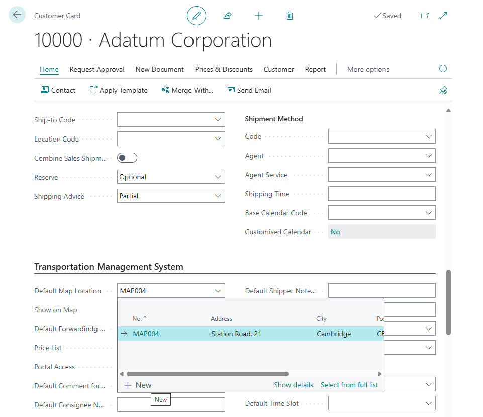
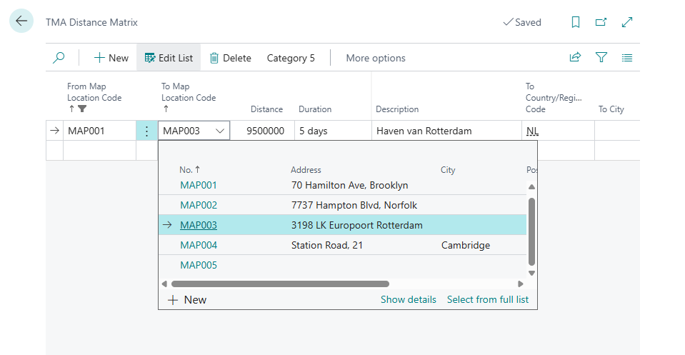

# Map Locations

Use **Map Locations** to store reusable geographic locations for TMS documents.

A map location can represent a customer site, vendor site, port, airport, terminal, warehouse, depot, or any planned stop used by your LSP process.

## Before you start

Make sure that:

- a map provider is configured in [TMS Setup](setup.md),
- country, city, postal code, and address data are accurate,
- map location types exist if your company classifies locations,
- users have permission to create or update map locations.

## How to create a map location

1. Search for **Map Locations**.
2. Choose **New**.
3. Enter code, name, type, and address details.
4. Choose the geocode action if coordinates are not filled automatically.
5. Review the map position.
6. Correct the position manually if the provider matched the wrong place. After typing coordinates, choose **Confirm Position**.
7. Save the location.

## Fields that matter most

| Field | Why it matters |
|---|---|
| **Code** | Identifies the location in documents and routes. |
| **Name** | Helps users select the right site. |
| **Map Location Type** | Classifies the location for filtering and reporting. |
| **Address fields** | Used for geocoding and printed documents. |
| **Latitude / Longitude** | Used for map display, route, distance, and duration. |
| **Position Is Set** | Shows whether the coordinate pair is confirmed for map and route use. |
| **Contact details** | Help users communicate with the location. |

## Confirming a position

**Position Is Set** is a read-only status. A confirmed position can come from an airport, successful geocoding, a saved **Exact Place**, or manual confirmation.

When you change latitude or longitude manually, the pair becomes a draft and **Position Is Set** is cleared. Check both values, then choose **Confirm Position** to make the pair available for maps and routes. Latitude must be between -90 and 90, and longitude between -180 and 180. Zero is allowed for either value, including an intentional pair of `0,0`; confirm it only when that is the intended location.

Choose **Clear Position** to remove both coordinates and their confirmation. Confirming a position establishes the geographic point; a map provider must still be configured for map services, and the point must be reachable for a road route to calculate.

## Airport locations

For an airport location, select **Airport Code**. If that airport has confirmed coordinates in **IATA Airports**, the location receives the pair and **Position Is Set** becomes selected. If the airport has no confirmed pair, the position is cleared; the selected airport remains on the location. Clearing **Airport Code** also clears the position.

You can refine an airport location to a particular cargo terminal by saving **Exact Place** or entering and confirming a different pair. Keeping the same airport code preserves that refinement. Choose **Use Airport Coordinates** only when you want to replace the current position with the airport's reference pair. Changing to a different airport also replaces the position.

### Confirm existing airport data

Existing airport coordinates require review before they are treated as confirmed:

1. Search for **IATA Airports**.
2. Check **Latitude** and **Longitude** against your trusted airport data.
3. Select only airports for which both values are known and choose **Confirm Coordinates**. **Has Coordinates** shows their confirmation status.
4. Use **Clear Coordinates** for airports whose pair should be removed. Changing either value clears confirmation until the pair is confirmed again.

Updating airport reference data does not automatically overwrite positions on existing Map Locations. This preserves manually selected terminals and gates.

On **Map Locations**, select existing airport locations and choose **Confirm Matching Airport Positions** to restore confirmation where the current pair exactly matches a confirmed IATA pair. The action confirms only locations whose **Position Is Set** is cleared and leaves their coordinates unchanged. Review other locations individually: use **Confirm Position** for a checked manual pair or **Use Airport Coordinates** to replace the pair with the airport reference.

## Route distance matrix

Use **Route Distance Matrix** when your process stores distance and duration between common locations. It contains provider-aware calculated cache entries and manual overrides.

Route distance matrix values can help reporting and planning, especially when the same lanes are used often. The former **Distance Matrix** object is retained only for compatibility; rows from it are copied to **Route Distance Matrix** during upgrade.

## Good to know

- Clean address data is the best way to improve geocoding quality.
- Coordinates should be reviewed for ports, terminals, large warehouses, and rural addresses.
- Use map location types to keep lookup lists easier to scan.

## Troubleshooting

| Problem | What to check |
|---|---|
| Geocoding returns the wrong place | Correct address fields or manually change the position. |
| Show on map is unavailable | Check **Position Is Set**. Confirm a checked manual pair or the airport reference coordinates. |
| Route does not calculate | Confirm all required locations have **Position Is Set** selected, then check provider setup and road access. |
| Location is hard to find | Improve name, type, and code naming convention. |
| Route distance matrix is missing | Check whether the lane has been calculated or entered in Route Distance Matrix. |

## Related

- [Map Location Types](maplocationtype.md)
- [Map Providers](mapproviders.md)
- [Google Maps Integration](googlemapintegration.md)
- [Routes](route.md)
- [Forwarding Order](forwardingorder.md)
- [Freight Order](freightorder.md)
- [Map Location API positions](api.md#map-location-positions)
