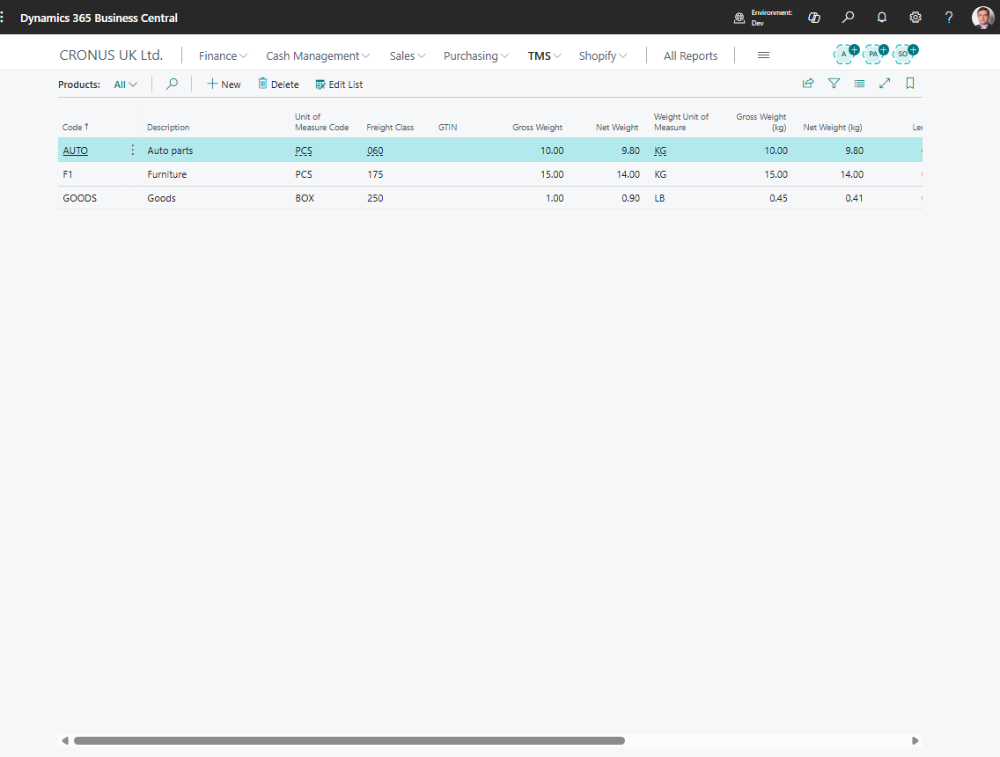

# Products

Use **Products** to maintain reusable cargo descriptions for Forwarding Order content.

A product can represent a generic cargo type, commodity, or item description used by operations and documents.

## Before you start

Make sure that:

- users agree which cargo descriptions should be standardized,
- logistic unit types exist when products are normally moved in standard units,
- any required weight, volume, or classification data is known.

## How to create a product

1. Search for **Products**.
2. Choose **New**.
3. Enter a code and description.
4. Fill weight, volume, unit, or classification details when used.
5. Save the product.
6. Select the product on Forwarding Order content lines when applicable.

## Fields that matter most

| Field | Why it matters |
|---|---|
| **Code** | Identifies the product in content lines and reporting. |
| **Description** | Prints or appears as cargo text. |
| **Unit data** | Helps calculate totals and documents. |
| **Weight / Volume** | Supports planning and settlement review. |
| **Blocked** | Prevents selecting the product on new content lines while preserving history. Copying an existing Forwarding Order retains its cargo, including blocked products, and shows a warning in the wizard. |
| **Transport Profile Count / Has Transport Profiles** | Shows unblocked profile assignments for this Product. These indicators do not confirm that an assignment is current or that its Profile is reviewed and suitable for a particular Stage. |

## Set up transport requirements for Products and Items

Use **Transport Profile Assignments** when cargo needs controlled dangerous-goods classification, packaging, temperature, or equipment requirements. The classification is maintained in a reusable [Transport Profile](transportprofiles.md), then linked to the cargo; it is not copied into the Product or Item.

| Cargo record | Where to open assignments | Supported scope |
|---|---|---|
| **TMS Product** | Select a record in **Products**, then choose **Transport Profiles**. | Product and optional Unit of Measure. **Variant Code** must remain blank. |
| **Business Central Item** | Open **Item Card** or select a record in **Items**, then choose **Transport Profiles**. | Item, optional Item Variant, and optional Item Unit of Measure. |

The Item Card also shows **Transport Profile Count** and **Has Transport Profiles** in **Transportation Management System > Transport Profiles**, after the Warehouse section. The Items list shows the count; the presence indicator is available through personalization. These indicators count unblocked assignments only, regardless of dates, review state, or transport context.

### Assign a Profile

1. Ask the responsible transport administrator to create and review the applicable [Transport Profiles](transportprofiles.md#how-to-configure-transport-profiles). Use a separate Profile when the Mode, Regulation, package, bulk, shipping state, or temperature scenario differs.
2. Open **Transport Profiles** from the Product or Item. The assignment list is filtered to that cargo record.
3. Add a row and select **Transport Profile Code**. The Profile must be unblocked. An unreviewed Profile can be assigned during setup, but cannot be selected on a Stage until its transport data is reviewed.
4. For an Item, enter **Variant Code** if the assignment is specific to a variant. Enter **Unit of Measure Code** when the scenario applies to a particular unit. An Item unit must already exist in that Item's units of measure; a Product unit comes from the general units of measure.
5. Leave Variant or UOM blank only when the assignment is a valid fallback for other variants or units.
6. Set **Default** and **Priority** to order eligible candidates. Higher priority values rank first; these fields do not override eligibility or automatically choose between several candidates during Stage selection. Dangerous Goods Bill of Lading uses a unique best rank to select each cargo profile automatically; see [Transport Profiles](transportprofiles.md#reports-and-documents).
7. Set **Effective From** and **Effective To** when needed. Both limits are inclusive; blank means no limit. The selection date is the Stage's **Start DateTime**, otherwise the Forwarding Order **Document Date**, otherwise the current **Work Date**.
8. Use assignment **Blocked** to disable this cargo-to-Profile link, and **Comment** to explain its purpose. Blocking an assignment does not block the Profile for other cargo.
9. On a representative Forwarding Order with direct Item or Product content lines, set the Stage context, choose **Suggest Transport Profile**, and run **Check Transport Profile**. See [Stages](stages.md) for the daily planning process.

You can also maintain assignments centrally through **Transport Profile Assignments**, or open **Assignments** on a Transport Profile card to see its cargo links.

### How Variant and UOM matching works

For an Item, TMS uses the first group containing eligible Profiles, in this order:

1. Exact Variant and exact UOM.
2. Exact Variant and blank UOM.
3. Blank Variant and exact UOM.
4. Blank Variant and blank UOM.

For a Product, exact UOM comes before blank UOM. Eligibility includes assignment dates and blocking, Profile review and blocking, Stage Mode and Regulation, Package Type when specified, and the selected Vehicle Unit Type. A more specific group with no eligible Profiles can fall back to a less specific group.

For example, a fictional Product `CARGO-A` could have an assignment for UOM `DRUM` to a reviewed drum Profile and an assignment for UOM `BULK` to a reviewed bulk Profile. For an Item, a variant can distinguish another product presentation as well. These are setup examples: your administrator must establish the real classification and allowed packaging before approval.

### Recommendations for planners and administrators

- Configure every direct Item or Product whose transport scenarios must restrict Stage selection. A line with no relevant assignment does not constrain the suggested Profile and still needs manual assessment.
- A line with relevant assignments that are all unusable produces an error; blocking or expiring its last eligible assignment does not make it unrestricted.
- Keep fallback assignments narrow enough to remain valid for every Variant or UOM they can cover. Use specific rows for packaging or product variations that change transport requirements.
- For several configured cargo lines, a Stage needs a common eligible Profile. The system checks the Forwarding Order's direct Item/Product lines, not the contents of Logistic Units; separate cargo into different Forwarding Orders when its allowed Profiles cannot be reconciled.
- Recheck affected Stages after changing assignments or Profiles. The presence indicator is a setup aid, not an approval or a shipment compliance result.

## Good to know

- Products in TMS are cargo descriptions. They do not replace standard Business Central items unless your process maps them that way.
- Keep product descriptions clear for customers and carriers.
- Use generic products only when detailed item tracking is not required.

## Troubleshooting

| Problem | What to check |
|---|---|
| Product is not available | Check whether it is blocked or filtered. |
| Cargo text is wrong on a document | Review the product description and the content line description. |
| Totals are wrong | Check quantity, unit type, weight, and volume on the content line. |
| A Profile is not offered for this cargo | Check the assignment's Variant/UOM, dates and Blocked value, then the Profile's review state, blocking, and compatibility with the Stage context. |
| The count is positive, but no Profile is eligible | The count includes unblocked assignments even when expired, not yet effective, or linked to a Profile that is blocked, unreviewed, or unsuitable for this Stage. |

## Related

- [Forwarding Order](forwardingorder.md)
- [Logistic Unit Types](logisticunittype.md)
- [Freight Order](freightorder.md)
- [Transport Profiles and Dangerous Goods](transportprofiles.md)
- [Stages](stages.md)
