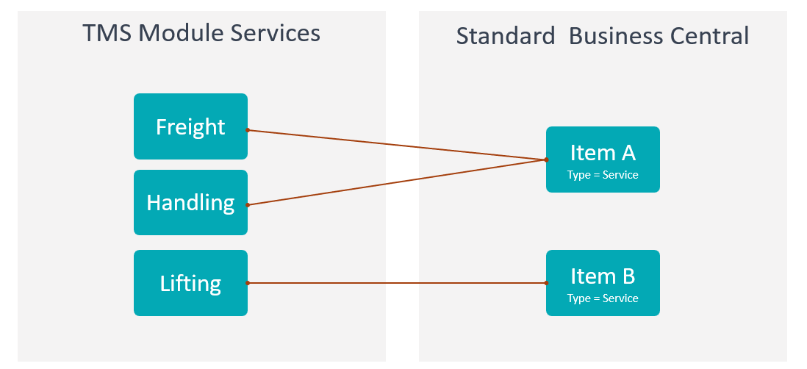

# Services

Use **Services** to define what your company charges customers for.

Services are the income side of settlement. Charges are the cost side.

## How to open the list

Open the **TMS Services** list from the navigation menu on your Role Center (home page):

- On a standard Role Center with the **TMS** menu, choose **TMS > Setup > Invoicing > Services**.
- On the **TMS Dispatcher** Role Center, choose **Setup > Invoicing > Services**.

## Before you start

Make sure that:

- Business Central posting setup exists for customer invoicing,
- service descriptions are agreed with finance and operations,
- pricing rules are configured if services should receive automatic prices,
- users know which services are standard and which are exception services.

## How to create a service

1. Open the **TMS Services** list using the menu path above.
2. Choose **New**.
3. Enter a code and description.
4. Fill posting, tax, unit, and pricing defaults when required.
5. Mark the service blocked only when it should no longer be used.
6. Test the service on a settlement income line.

## Fields that matter most

| Field | Why it matters |
|---|---|
| **Code** | Identifies the service on settlement lines. |
| **Description** | Appears on invoices and internal reports. |
| **Posting mapping** | Controls customer invoice creation. |
| **Default for Sales Import** | Chooses this service when several services have the same **Invoice Line - Type / Invoice Line - No.** and a sales line is imported into TMS. It is enabled automatically when you configure the first mapping for that type and number. |
| **Unit of Measure** | Controls quantity and price interpretation. |
| **Blocked** | Prevents new use while preserving history. |

## Where services are used

| Area | Use |
|---|---|
| **Settlement income lines** | Defines what the customer is billed for. |
| **Default Service Sets** | Predefines services or charges together with their Financial Effect and Pricing Mode for new Forwarding Orders. |
| **Pricing** | Finds or calculates expected income. |
| **Sales documents** | Creates customer invoice or credit memo lines. |
| **Reporting** | Shows revenue by service. |

## Choose a service for sales import

Several Services can use the same Business Central item, account, or resource for invoicing. When importing a sales line, TMS must choose which Service its **Type / No.** represents.

When you select or change **Invoice Line - Type / Invoice Line - No.**, TMS enables **Default for Sales Import** if the complete pair is not used by any other Service in the company. A second Service using the pair starts with its flag off, even if the existing Service is not marked. Incomplete mappings also leave the flag off.

1. In **TMS Services**, filter **Invoice Line - Type** and **Invoice Line - No.** to the source line's values.
2. Review **Default for Sales Import**. Enable it on the Service you want to prefer over other matches. Only one Service may be marked for the same type and number in the company. To change the default, clear the old flag before selecting the new one. You may also leave all flags off to use the first matching Service by **Code** in ascending order.
3. Confirm that the selected Service is allowed by the Forwarding Order Type's **Allowed Service/Charges Set**, when configured.

If another matching Service is already marked, TMS rejects enabling a second default and identifies the existing Service. Clear that Service's flag before marking the replacement; this also applies when another user has just selected the default.

You can clear the flag manually; saving the Service or selecting the same mapping again preserves that choice. Changing the mapping to a different pair recalculates the flag: an unused complete pair enables it, while a pair used by another Service or an incomplete pair clears it. This does not change flags on other Services.

A single matching Service is used even when its flag is off. With several matches, a marked default takes priority. If none is marked, TMS uses the first matching Service by **Code** in ascending order, independently of the list's sorting, filters, or record creation order. This fallback does not enable a flag or change any Service record. No matching Service or multiple marked defaults stops import with an error. The rule applies to open sales orders, invoices, and credit memos, and posted sales invoices and credit memos. For example, if both **Transport** and **Waiting** map to Item `1006`, marking **Waiting** sends automatically imported Item `1006` lines to that Service even when another code sorts first.

The flag does not restrict manual Service selection or change invoicing from TMS. Changing it does not reclassify existing Settlement links or historical records. The selection rule applies to the type and number across the company; it does not choose different Services by customer, amount, or description. If the selected default or first-code fallback is excluded by the FWO type's allowed set, import stops with an error; TMS does not try another matching Service.

When upgrading from a version without this setting, existing Services start with the flag off; TMS does not choose defaults for them automatically. Single mappings continue to work, and shared mappings use the first matching **Code** in ascending order without requiring setup changes. Mark a default when you want to choose a different Service. See [Import an existing sales document](settlement.md#import-an-existing-sales-document).

## Good to know

- Use clear invoice-friendly descriptions.
- Do not mix services and charges. Services are income. Charges are cost.
- In a Default Service Set, choose **Standard** or **Credit** Financial Effect and **Per Unit** or **Fixed Amount** Pricing Mode before the set is used by a Forwarding Order Type.
- Lines copied from a Default Service Set remain editable Settlement drafts until they are linked to a document.
- Before invoicing, follow [Add an Income line](settlement.md#add-an-income-line). **Unit of Measure Code** must be filled on every Income line, including fixed fees and services mapped to a G/L account or resource.
- Block obsolete services instead of deleting them.

## Troubleshooting

| Problem | What to check |
|---|---|
| Service cannot be selected | Check whether the service is blocked. |
| Invoice line is wrong | Review service description, posting mapping, quantity, price, and tax setup. |
| Price is missing | Check pricing setup, customer, agreement, currency, and validity dates. |
| User cannot create invoice | Check settlement status, permissions, and TMS Setup. |
| Sales import cannot choose a Service | Filter by the source **Type / No.**. Configure a missing mapping or correct multiple marked defaults. With no marked default, the first matching **Code** in ascending order is selected; the selected Service must also be allowed by the FWO type. |
| Import selected a different Service than expected | Mark the intended matching Service as **Default for Sales Import**. With all flags off, selection uses **Code** ascending, not the order shown in the list. |

## Related

- [Settlement](settlement.md)
- [Pricing](pricing.md)
- [Charges](charges.md)
- [TMS Setup](setup.md)
