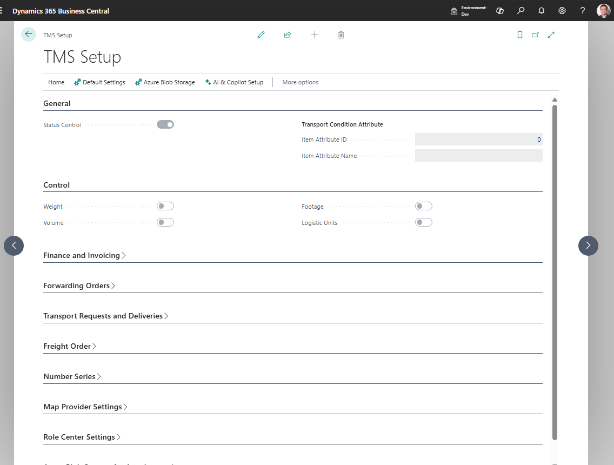

# TMS Setup

Use **TMS Setup** to define default behavior for the Logistics Service Provider workflow.

This page controls Forwarding Order defaults, Freight Order defaults, finance behavior, price list behavior, map provider settings, role center filters, Azure Blob Storage for attachments, and report defaults.

## How to open the page

Use one of these options:

- search for **TMS Setup**,
- open it from **Manual Setup**,
- open it from the TMS role center if your role center includes setup actions.

## Minimum setup checklist

Complete these items before users start working:

1. Fill the number series used by TMS.
2. Select the default [Forwarding Order Type](forwardingordertype.md).
3. Create status profiles for Forwarding Orders and Freight Orders.
4. Create stage profiles for the transportation process.
5. Set up [Services](services.md) for customer billing.
6. Set up [Charges](charges.md) for vendor and carrier costs.
7. Configure posting controls for settlement and Forwarding Order posting.
8. Configure [Freight Order Types](freightordertype.md).
9. Configure map provider settings if distance or route calculation is used.
10. Configure [Azure Blob Storage for Attachments](azureblobstorage.md) when external file storage is used.
11. Configure [Transport Profiles](transportprofiles.md) and Emergency Response when your process uses dangerous-goods, temperature, or equipment compatibility controls.
12. Choose **Set default reports** if report selections are missing.

## Setup by process

| If your company uses | Set up these areas |
|---|---|
| Basic forwarding | Forwarding Order Types, number series, statuses, and stages. |
| Carrier execution | Freight Order type, carriers, vehicles, drivers, and stage rules. |
| Dangerous goods and equipment compatibility | [Transport Profiles](transportprofiles.md), Transport Regulations, Modes of Transport, Package Types, Vehicle Unit Types, and Emergency Response. |
| Customer invoicing | Services, service mapping, customer currency, and posting setup. Settlement now chooses Sales Order or Sales Invoice through an explicit action. |
| Carrier cost allocation | Charges, purchase line mapping, settlement controls, and vendor setup. |
| Price automation | Price List Enabled, default price list, services, and price records. |
| Map and route calculation | Map Provider, API key, map locations, and coordinates. |
| Attachment governance | Attachment categories, Azure Blob Storage, and status requirements. |
| Guided order creation | Forwarding Order Types, Freight Order Types, number series, and [Order Wizards](orderwizards.md). |
| Role Center monitoring | Filter captions and values for role center cues. |

## Settings most teams review

| Area | What to review |
|---|---|
| **General** | Global status control and core default behavior. |
| **Instructions** | Enable instruction sections and open the reusable [Instructions and Instruction Types](instructions.md) setup pages. |
| **Control** | Weight, volume, footage, and logistic unit controls. |
| **Finance and Invoicing** | Date behavior, credit limit warnings, and posting controls. The former Invoice Document Type is retained only for compatibility and is no longer used by the new Settlement actions. |
| **Price List** | Whether pricing is enabled and which price list is used by default. |
| **Forwarding Orders** | Default type and source defaults. |
| **Freight Order** | Default type, unit type, charge distribution precision, execution status profile, and Bill of Lading numbering. |
| **Emergency Response** | Company-level provider, primary/international phones, contact, contract ID, and notes. The bundled Dangerous Goods Bill of Lading prints the provider and phones; contact and contract ID are available to custom layouts. |
| **Map Provider Settings** | Google Maps or Azure Maps, with one masked provider key used by server requests and browser visualization. Review the displayed external-service disclosure before entering a key. |
| **Role Center Settings** | Cue filter captions and values. |
| **Azure Blob Storage** | External storage for TMS attachments. The account key is masked and stored encrypted with company scope. |
| **Reports** | Default report selection setup. |

## Default Forwarding Order Type by customer, vendor, and address

Use **Default FWO Type** on the **Customer Card**, **Vendor Card**, **Ship-to Address**, or **Order Address** card to suggest a transportation process on sales and purchase documents.

The document stores that suggestion in **FWO Type**, in its **Transportation Management System** section. You can change **FWO Type** manually before creating the Forwarding Order, including on a released Sales Order. Once a Forwarding Order is linked, the field becomes read-only.

| When selecting or changing | Suggested FWO Type |
|---|---|
| Sell-to Customer or Ship-to Code on a sales document | Selected Ship-to Address default → Sell-to Customer default → blank. |
| Buy-from Vendor or Order Address Code on a purchase document | Selected Order Address default → Buy-from Vendor default → blank. |

For example, set a domestic type on a customer and a multimodal type on its overseas Ship-to Address. Selecting that address fills the sales document's **FWO Type** with the multimodal type. For a particular shipment, you can choose a different type directly on the document.

Before an FWO is linked, changing the customer, vendor, or selected address refreshes the suggestion. Clearing the address uses the customer or vendor default. If neither default is set, the document field becomes blank. Unrelated edits and revalidating an unchanged customer/address combination preserve your manual value. Changing a default on a master-data card does not update existing documents.

When creating the Forwarding Order, TMS uses **FWO Type** stored on the source document. It does not read customer or address defaults again. If the document field is blank, the existing behavior remains:

- Standard creation from a Sales Order or Sales Return Order uses **Default Sales FWO Type**. If that setting is blank, an interactive session opens the type selection; cancelling stops creation. Without an interactive session, the setup default is required.
- Creation from purchase documents, posted sales or purchase documents, and combined shipments requires the corresponding default in TMS Setup.
- For sales **Create FWO as LSP**, **Select FWO Type for LSP** controls selection when the document's **FWO Type** is blank. A populated document field takes priority.

The stored type is copied to posted and archived sales and purchase headers. Existing documents with a blank field keep the same fallback behavior until you set **FWO Type** or change their customer, vendor, or address. While an FWO is linked, manual changes to **FWO Type** are blocked and customer/address changes keep its saved value. The lock also applies when the linked FWO has been posted.

See [Business Central Integration](integration.md#default-fwo-type-from-source-documents) for supported sources, inventory documents, and returns.

## Bill of Lading numbering

Open **TMS Setup > Freight Order > Bill of Lading Numbering**. This group contains three fields:

| Field | Use it for |
|---|---|
| **Numbering Method** | Leave blank for no automatic numbering, choose **Prefix + Freight Order No.**, or choose **No. Series**. |
| **Prefix** | Enter the text to place directly before the Freight Order number. Editable only for **Prefix + Freight Order No.**. |
| **No. Series** | Select an independent Bill of Lading number series. Editable only for **No. Series**. |

Switching methods retains the saved Prefix and No. Series values. Selecting a method does not require you to have already filled its series; the required settings are checked when a Freight Order is created.

With **Prefix + Freight Order No.**, the prefix is joined literally to the **Freight Order No.** Include any separator in the prefix. For example, **BOL-** plus **FO-00001** produces **BOL-FO-00001**. A blank prefix uses the Freight Order number alone. The complete result must fit the existing 20-character Bill of Lading No. field; a longer result causes a clear error and is never truncated.

With **No. Series**, select a series with **Default Nos.** enabled. Business Central takes the next number from the series line valid for the Freight Order's **Document Date**, or the work date if Document Date is blank. For example, a configured series can produce **BOL00001**. A missing series, disabled Default Nos., or an unusable date-specific series line prevents creation with a clear error.

Automatic numbering runs only when a Freight Order is created, after its own number exists. This covers creation from the card, wizards, and the API, including API requests that supply an explicit Freight Order number. An already populated Bill of Lading No., including a manually supplied number, is preserved. Temporary records do not consume Bill of Lading sequence numbers.

Changing setup does not fill or renumber existing orders. Editing or renaming an order and printing reports do not generate or recalculate its Bill of Lading No. Reports continue to read the stored value, and posting copies that value to the Posted Freight Order.

## Useful actions

| Action | Use it for |
|---|---|
| **Set default reports** | Reset default report selections for TMS documents. |
| **Check Connection** | Test Azure Blob Storage connection. |
| **Transfer Attachments to ABS** | Move existing TMS attachments to Azure Blob Storage. |
| **Free Space** | Remove imported file payload after transfer to Azure Blob Storage. |
| **Assisted Setup** | Open the TMS wizard, configure a map provider, and reconcile MAP Locations for customers, vendors, ship-to addresses, order addresses, and locations. |

Google Maps and Azure Maps receive address, coordinate, route, and travel-mode data when map operations run. Review [privacy and outbound data transfer](mapproviders.md#privacy-and-outbound-data-transfer), then record the organization-level decision on the standard Business Central **Privacy Notices Status** page when required by company policy.

## Verify setup

1. Search for **Forwarding Orders** and confirm the page opens.
2. Create a test Forwarding Order.
3. Confirm a Forwarding Order Type can be selected.
4. Confirm stages and statuses appear as expected.
5. Add one settlement income line and one cost line.
6. Confirm the expected invoice and charge actions are available.
7. Create a Freight Order from a stage.
8. Run the [first forwarding job tutorial](first-forwarding-job.md) in a sandbox.

## Troubleshooting

| Problem | What to check |
|---|---|
| Forwarding Order cannot be created | Check default Forwarding Order Type, number series, and permissions. |
| Freight Order action is disabled | Check the Forwarding Order status and status profile permissions. |
| A Transport Profile is not suggested or reviewed | Check [Transport Profiles](transportprofiles.md), cargo assignments, Mode/Regulation, required classifications, and permissions. |
| Settlement cannot create an invoice | Check service mapping, invoice document type, customer, and status permissions. |
| Posting is blocked | Review posted document control, settlement document posting, and FWO posting date control. |
| Attachments do not move to Azure Blob Storage | Check account name, container, account key, and **Check Connection** result. |
| Upgrade cannot migrate the Azure Blob Storage key | Rotate or re-enter a supported account key, retry the upgrade, and run **Check Connection** afterward. The old plaintext value is not cleared when migration fails. |

## Related

- [Forwarding Order Types](forwardingordertype.md)
- [Freight Order Types](freightordertype.md)
- [Statuses and Status Profiles](statuses.md)
- [Stages](stages.md)
- [Settlement](settlement.md)
- [Azure Blob Storage for Attachments](azureblobstorage.md)
- [Map Providers](mapproviders.md)
- [Google Maps Integration](googlemapintegration.md)
- [Attachment Control](attachmentcontrol.md)
- [Transport Profiles and Dangerous Goods](transportprofiles.md)
- [Instructions](instructions.md)
