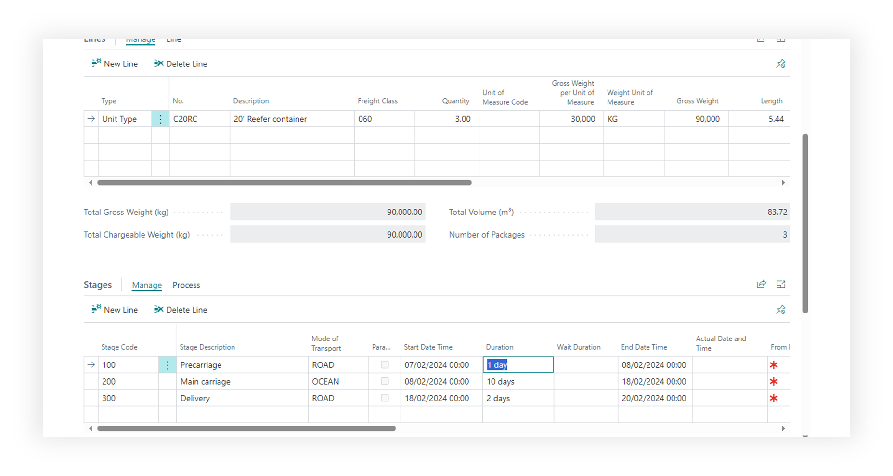

# Stages

Use **Stages** to define the transportation legs of a Forwarding Order.

A stage can represent pickup, pre-carriage, main carriage, on-carriage, terminal handling, customs-related movement, or another leg your company tracks.

## Before you start

Make sure that:

- the business process is mapped,
- map locations or party address rules are ready,
- status profiles exist,
- Forwarding Order Types are ready to use stage profiles.

## Stage profiles

A **Stage Profile** is a reusable list of stages that can be assigned to a Forwarding Order Type.

Integrations can read profiles through `stageprofiles` and their reusable legs
through `stagedefinitions`, filtered by `stageProfileCode`. A definition is
identified by its profile and code together. The existing `stages` API contains
the actual legs of orders. See [Process setup APIs](api.md#forwarding-order-types-stage-profiles-and-status-profiles).

When users create a Forwarding Order, the stage profile helps create the expected transportation legs automatically.

A **Stage Profile** defines the route/process template. A **Transport Profile** defines one reviewed cargo transport scenario, including dangerous-goods classification and equipment rules. The Stage Profile supplies planning defaults; the planner selects the Transport Profile on each actual Forwarding Order stage after checking its cargo and transport context.

## How to create a stage profile

1. Search for **Stage Profiles**.
2. Choose **New**.
3. Enter code and description.
4. Add stage lines in the expected sequence.
5. Fill stage type, locations, mode, and defaults when used.
6. Assign the profile to a Forwarding Order Type.
7. Test by creating a Forwarding Order.

## Fields that matter most

| Field | Why it matters |
|---|---|
| **Sequence** | Controls the order of stages. |
| **Stage Code** | Identifies the leg. |
| **Description** | Helps users understand the leg. |
| **Mode of Transport** | Classifies the stage and supplies the default Transport Regulation. |
| **Vehicle Unit Type** | Supplies the default stage equipment type and filters eligible Transport Profiles. |
| **Package Type** | Supplies the default packaging context. When filled, only Transport Profiles with the same Package Type are eligible. |
| **Transport Regulation** | Overrides the regulation defaulted by Mode of Transport when the stage needs a different active regulation. |
| **Transport Profile** | Is selected on the Forwarding Order stage from profiles compatible with mode, regulation, package type, vehicle unit type, and configured cargo assignments. |
| **Default Carrier** | Supplies the carrier proposed for a new Forwarding Order stage and, through that stage, for Freight Order creation. |
| **Default Pay-to Vendor** | Supplies the vendor proposed for payment of the carrier service on a new Forwarding Order stage and Freight Order. |
| **Origin / Destination** | Defines the movement for the leg. |
| **Status Profile** | Controls stage or execution behavior when used. |
| **Create Freight Order** | Indicates whether carrier execution is expected for the stage. |

## Select a Transport Profile on an order stage

Prepare reviewed profiles and their Item/Product assignments as described in [Transport Profiles and Dangerous Goods](transportprofiles.md). Then:

1. Open the Forwarding Order and review its direct **Item** and **Product** lines, including Variant and Unit of Measure.
2. In **Stages**, select the relevant line or open its **Stage Card**.
3. Check **Mode of Transport** and **Transport Regulation Code**. The Mode supplies its default regulation; a regulation on the Stage Profile line overrides that default when the stage is created.
4. Set **Vehicle Unit Type Code** to the equipment planned for this leg. Set **Package Type Code** when the leg must use a particular package form. Package Type describes the cargo packaging; Vehicle Unit Type describes the equipment.
5. Check **Start DateTime**. Assignment validity uses its date, falling back to the Forwarding Order Document Date and then the Work Date.
6. Choose **Suggest Transport Profile**. One common eligible profile is applied automatically; several candidates open a selection list. The **Transport Profile Code** lookup opens that list even when only one candidate exists.
7. Choose **Open Transport Profile** to read the classification and handling requirements, then **Check Transport Profile** to check the selected profile against the current context and configured cargo assignments.
8. After assigning the stage to a Freight Order, choose **Check Vehicle Unit Type** on that order to check equipment rules, temperature boundaries, and any required conditional confirmation.

Both Mode and Regulation must be filled before suggestion or lookup. A candidate must be reviewed and unblocked, match Mode and Regulation, match Package Type when the stage specifies one, and allow the stage Vehicle Unit Type when it is filled. For a profile with equipment rules, unlisted and Blocked vehicle types are excluded. A blank Package Type or Vehicle Unit Type does not narrow the candidate list by that field.

For configured cargo, TMS uses the effective assignments in the first eligible Variant/UOM group and finds profiles common to all participating direct Item/Product lines. Lines with no relevant assignments do not restrict the list. If no direct line is configured, the list contains profiles matching the stage context. Relevant assignments that exist but are all blocked, expired, or unsuitable cause an error. See [Selecting a profile on a stage](transportprofiles.md#selecting-a-profile-on-a-stage) for the full selection rules.

### Recheck after planning changes

| Change | What happens and what to do |
|---|---|
| Mode of Transport changes | The selected Transport Profile and Regulation are cleared, then the new Mode's default Regulation is applied. Check the context and select the profile again. |
| Regulation changes | A profile using a different regulation is cleared. Only active regulations can be selected. |
| Vehicle Unit Type changes | An unlisted or Blocked combination clears the profile. For an unassigned stage that retains its profile, equipment temperature limits and conditional instructions are checked immediately. |
| Package Type changes | A filled Package Type that differs from the profile clears the profile. Clearing Package Type removes that filter. |
| Start date, cargo, assignments, or profile data changes | Run **Check Transport Profile** again. The selected code is not a saved approval or a frozen copy of the master data. |
| A stage is attached to a Freight Order or its transport context changes there | The supported save/assignment flow checks the current profiles and equipment when the Freight Order has a Vehicle Unit Type. Run the explicit Freight Order check before execution. |
| A Freight Order split creates a parallel stage | The copied stage clears its Transport Profile. Review its retained planning context and select a suitable profile. |

### Scope and practical limits

- Every stage checks the direct Item/Product lines of the entire Forwarding Order. Adding another stage does not allocate different cargo lines to it. Separate cargo requiring incompatible common profiles into different Forwarding Orders.
- The Transport Profile check does not inspect contents inside Logistic Units or Service lines. The **Transport Profile Count** on an order line shows unblocked assignments, not the number of profiles eligible for the current stage.
- A service or handling stage with no Mode/Regulation cannot use profile suggestion. There is no automatic service-stage exemption in the Freight Order's explicit **Check Vehicle Unit Type** action: it requires a profile on every linked stage, a Vehicle Unit Type on the Freight Order, and at least one linked stage.
- A stage's explicit Vehicle Unit Type is authoritative for that stage; the Freight Order header supplies the fallback only when the stage field is blank. Different stages can therefore retain different equipment types.
- **Check Transport Profile** checks the profile and cargo assignments. Full equipment temperature checks and Conditional equipment confirmation are separate; use **Check Vehicle Unit Type** on the Freight Order. Conditional classification rules are not evaluated against shipment facts by the standard stage actions.
- **Transport Profile Assignments** shows the effective, unblocked assignments participating in the selected profile as a read-only list. A manually chosen profile for entirely unconfigured cargo has no participating assignment to display.

Use the profile and equipment checks as explicit planning steps. They do not create a compliance status, retain a conditional confirmation, or form a general release/posting approval gate.

## Stages after Freight Order posting

Post a Freight Order after completing all work assigned to it, posting its linked purchases, and fully allocating its charges to Forwarding Order Settlement. Its complete stage execution is saved in the Posted Freight Order, including stages from every Forwarding Order on the trip.

A related Forwarding Order may still be active. Its stage lines remain visible and retain the Freight Order number and the link to the exact posted trip. The saved execution details are read-only; the completed trip cannot be reassigned as active execution. Later Forwarding Order posting completes the links to that job's posted version without creating another Freight Order archive or changing its execution snapshot.

Before posting a Forwarding Order, post every Freight Order assigned to its stages. Posting refreshes stored stage links automatically from the related order numbers and stage line. The completed trip stage must exist and be uniquely identifiable in history; absence of the active Freight Order alone is not proof that the trip was posted.

Assign, remove, or transfer stages while the affected Freight Orders are still active. If another user changes their related orders and an operation asks you to retry, refresh the orders and check the current assignment first. If the Freight Order has already been posted, open its history to review the saved execution; that execution cannot be reassigned.

## Good to know

- Stages are the bridge between customer job planning and carrier execution.
- Mode, Vehicle Unit Type, Package Type, Transport Regulation, Default Carrier, and Default Pay-to Vendor are copied from the Stage Profile line to every new Forwarding Order stage.
- Package Type is optional on the stage. A blank value does not restrict Transport Profile selection.
- Keep stage profiles simple enough for users to understand.
- Different Forwarding Order Types can use different stage profiles.

## Troubleshooting

| Problem | What to check |
|---|---|
| Stages do not appear on a new order | Check the Forwarding Order Type and selected stage profile. |
| Freight Order cannot be created for a stage | Check stage setup, current status, and status action control. |
| Stage order is wrong | Review sequence values in the stage profile. |
| **Show stage route** reports a missing location | Open **Stage Card** and fill the **From Location** or **To Location** field named in the message. If the referenced Map Location no longer exists, select an existing one. Then try **Show stage route** again. |
| **Show stage route** reports missing coordinates | Open the [Map Location card](maplocation.md) for the code named in the message and set its coordinates. Both stage locations need coordinates before the route can be shown. **Stage Card** remains available for filling the missing data. |
| A Transport Profile is missing from the lookup | Check review/block status, Mode, Regulation, Package Type, Vehicle Unit Type, assignment dates, and Variant/UOM matching. |
| No common Transport Profile exists | Correct the assignments or separate incompatible cargo into different Forwarding Orders; adding another stage alone does not change which direct cargo lines are checked. |
| A previously selected profile no longer validates | Master data or assignments may have changed. Review the current source data and repeat the profile and Freight Order equipment checks. |

## Related

- [Forwarding Order Types](forwardingordertype.md)
- [Forwarding Order](forwardingorder.md)
- [Freight Order](freightorder.md)
- [Statuses and Status Profiles](statuses.md)
- [Transport Profiles and Dangerous Goods](transportprofiles.md)
