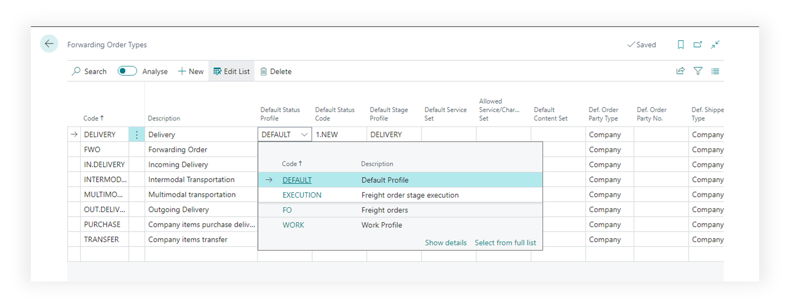

# Statuses and Status Profiles

Use **Statuses** and **Status Profiles** to control the business process for TMS documents.

Statuses are process steps. They are not the physical location of the cargo. They control what users can change, create, invoice, attach, or post.

## Before you start

Make sure that:

- your process steps are agreed with operations and finance,
- attachment categories exist if documents are required at certain steps,
- TMS Setup has status control enabled when you want action rules enforced,
- administrators understand which actions should be allowed at each status.

## What is a status profile

A **Status Profile** is a reusable set of statuses and action rules.

Integrations can read `statusprofiles` and retrieve the profile's `statuses` with
a `statusProfileCode` filter. Always match a status by profile and code together.
The returned settings explain configuration; they do not guarantee that an action
or status change will pass all document checks. See [Process setup APIs](api.md#forwarding-order-types-stage-profiles-and-status-profiles).

Assign status profiles to Forwarding Order Types, Forwarding Orders, Freight Orders, or stage execution rules depending on your setup.

## How to configure a profile

1. Search for **Status Profiles**.
2. Create or open a profile.
3. Add statuses in the business sequence.
4. Define which actions are allowed at each status.
5. Add extended control when attachments or extra requirements are needed.
6. Assign the profile to the related setup record.
7. Test the profile with a sample Forwarding Order.

## Common action controls

| Control | What it allows or blocks |
|---|---|
| **Change Order Type** | Lets users change the Forwarding Order Type. |
| **Party Details Change** | Lets users edit origin and destination party details. |
| **Lines Change** | Lets users add or change content lines. |
| **Date Planning** | Lets users change planning dates. |
| **Route Planning** | Lets users change stages or route-related data. |
| **Delete Document** | Lets users delete the document. |
| **Logistic Units Build** | Lets users build logistic units. |
| **Create Freight Order** | Lets users create carrier execution from stages. |
| **Invoicing** | Lets users create customer financial documents. |
| **Settlement** | Lets users change settlement lines. |
| **Post** | Lets users post a Forwarding Order or Freight Order in this status. |
| **Copy** | Lets users copy data when allowed. |
| **Extended Control** | Adds extra requirements such as required attachments. |

## Extended control

Use **Extended Control** when a status should require specific attachment categories or other configured checks.

Example: before a Forwarding Order can move to a controlled status, the system can require a carrier confirmation file, customer approval file, or invoice support file.

### Require a Forwarding Order field condition

Use a **Field Required** rule to define the value a Forwarding Order field must have before it can enter a status.

1. Open **Status Profiles (TMS)** and the profile assigned to the Forwarding Order.
2. Enable **Action Control Enabled** for the profile.
3. Select the target status and enable **Extended Control**.
4. Choose **Extended Control Setup**.
5. Add a line with **Type** set to **Field Required**.
6. Select **FWO Field No.**, then choose **Condition** and enter **Condition Value** when needed.

TMS Setup must also have **Status Control** enabled. Each configured field rule must pass when the Forwarding Order enters the target status.

| Condition | Meaning | Condition Value |
|---|---|---|
| **Not Empty** | The field's displayed text is not empty. | Leave blank. |
| **>** | A numeric field is greater than the specified number. | A number, such as `0` or `12.5`. |
| **<** | A numeric field is less than the specified number. | A number, such as `100` or `12.5`. |
| **=** | The field matches the specified text exactly, including case and spaces. | One value; leave blank to require empty comparison text. |
| **Must be Yes** | A Boolean field must be enabled (true). | Leave blank. |
| **Must be No** | A Boolean field must be disabled (false). | Leave blank. |
| **In List** | The field matches one of the listed values. | Values separated by commas, such as `Company,Customer`. |

For example, to require positive **Estimated Footage**, select that field, choose **>**, and enter `0`. A value of `0` then blocks the status change. To require payment, select **Paid** and choose **Must be Yes**.

**Not Empty** keeps the existing Field Required behavior: a numeric `0`, a Boolean `false`, or an empty GUID has nonempty displayed text and can pass. Use a more specific condition when your process needs a positive number, a Yes/No value, or a particular enum value. Existing rules use **Not Empty** until you change their condition.

For **>** and **<**, always enter the number with a decimal point (`12.5`), without thousands separators, regardless of your regional settings. These conditions are available for numeric fields only. **Must be Yes** and **Must be No** are available for Boolean fields only.

For **=** and **In List** on Enum and Option fields, enter the exact internal **name** of the value, not its displayed caption or numeric value. For example, if the name is `InProgress` and the caption is `In Progress`, enter `InProgress`. For **Order Party Type**, use `Customer` or the list `Company,Customer`. These names stay the same when users change their session language.

For other field types, **=** and **In List** compare the exact displayed value in the language and regional format of the user or integration that changes the status. Numbers, dates, and times can therefore depend on the session format. For Boolean requirements, prefer **Must be Yes** or **Must be No**.

**In List** ignores spaces around each list item but keeps spaces within a value. Empty items, such as `Company,,Customer`, are invalid. A comma always separates values; values containing a comma cannot be listed. If your decimal format uses a comma, use **=** for one fractional value or **>**/**<** for a numeric threshold.

The field selector offers supported value fields, including calculated fields. Calculated fields are evaluated before the condition is checked. An unsupported field or an incompatible condition produces a configuration error.

## Good to know

- Status control should make work clearer, not slower.
- Keep the number of statuses practical.
- Test every status profile with the users who perform the work.
- Use attachment requirements only for documents that are truly mandatory.

## Troubleshooting

| Problem | What to check |
|---|---|
| User cannot change a field | Check the current status and action control. |
| Freight Order action is disabled | Check **Create Freight Order** control for the current status. |
| Invoice action is disabled | Check **Invoicing** and settlement controls. |
| Posting is blocked | Check **Post** for the document's status. Before posting a Freight Order, complete linked purchases and charge allocation. Before posting a Forwarding Order, post every Freight Order assigned to its stages and complete its remaining posting controls. |
| A status change fails a field rule | Open **Extended Control Setup** for the target status and check the field, condition, and condition value. |
| Status rules do not apply | Check whether status control is enabled in TMS Setup. |

## Related

- [TMS Setup](setup.md)
- [Forwarding Order Types](forwardingordertype.md)
- [Forwarding Order](forwardingorder.md)
- [Attachment Control](attachmentcontrol.md)
- [Settlement](settlement.md)
